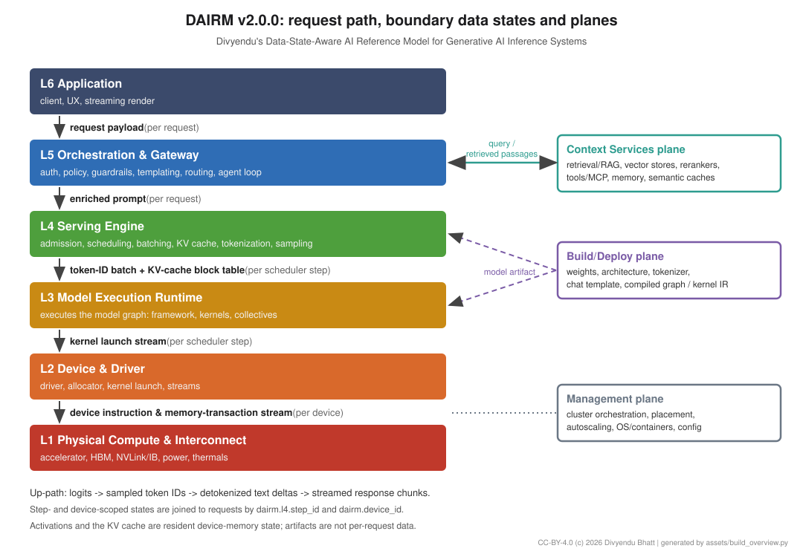

# DAIRM: Divyendu's Data-State-Aware AI Reference Model for Generative AI Inference Systems

**A reference model for the request path of generative AI inference: six layers, three planes, a named data state at every boundary, and a diagnostic method built on them.**

**Author:** Divyendu Bhatt (independent researcher) · **Contact:** Divyendu.bhatt@gmail.com · [github.com/CodingThrill0012](https://github.com/CodingThrill0012)
**Document:** [DAIRM-TR-0001](docs/DAIRM-TR-0001.md) · **Version:** 2.0.0 · **Status:** Technical Report / Working Draft (not an IETF RFC and not a standard)
**Publication status:** IETF Internet-Draft draft-bhatt-dairm-00 prepared, submission pending (not yet submitted; no RFC number; not an IETF standard). arXiv submission pending.
**License:** [CC-BY-4.0](LICENSE) · © 2026 Divyendu Bhatt · **Supersedes:** AOSI v1.2.1

[](https://doi.org/10.5281/zenodo.24073121) [](https://doi.org/10.5281/zenodo.24123645)



*Figure generated from [`assets/build_overview.py`](assets/build_overview.py); Mermaid source in [`assets/dairm-overview.mmd`](assets/dairm-overview.mmd).*

---

## Contents

1. [Overview](#1-overview)
2. [The Model at a Glance](#2-the-model-at-a-glance)
3. [Independent Development and Related Work](#3-independent-development-and-related-work)
4. [Repository Structure](#4-repository-structure)
5. [How to Participate](#5-how-to-participate)
6. [How to Cite](#6-how-to-cite)
7. [AI-Assistance Disclosure](#7-ai-assistance-disclosure)

---

## 1. Overview

### 1.1 The problem

A single generated token is the product of a long causal chain. A client sends a JSON request. A gateway applies policy, templates and conversation state, and may call retrieval or tools. A serving engine tokenizes, schedules and batches the request against a shared KV cache. A runtime executes the model graph as kernels, a driver launches them, and accelerators move bytes across HBM and interconnects under power and thermal limits.

Each part has its own tools, telemetry and owners, so when something goes wrong it is hard to say *where*. A slow response can come from retrieval, scheduler queueing, KV-cache preemption, a slow kernel or memory-bandwidth limits, and each looks like "the model is slow".

### 1.2 What DAIRM adds

DAIRM borrows the *method* of layered reference models such as OSI (ordered layers, service boundaries, named data units) and applies it to generative AI inference. It does **not** claim the layered-stack idea or the OSI analogy as new; earlier OSI-inspired AI models exist (see §3). Its contributions are limited to three things:

1. **A named, observable data state at every boundary of the inference request path**, each of which can be captured or measured: per request above the serving engine, and per scheduler step or device below it, joined to requests through a step identifier (`dairm.l4.step_id`).
2. **A boundary-attributed latency diagnostic method** that separates context-service delay, serving-engine queueing or KV-cache pressure, and memory-bandwidth-bound decode.
3. **A layer-indexed telemetry attribute set (`dairm.*`)** that makes the method executable on OpenTelemetry traces.

The down-path data states are:

```text
request payload → enriched prompt → token-ID batch + KV-cache block table → kernel launch stream → device instruction & memory-transaction stream
   (L6 → L5)         (L5 → L4)                (L4 → L3)                          (L3 → L2)                     (L2 → L1)
```

Context services return **retrieved passages** (text, scores, provenance) to L5. On the way back, logits become sampled token IDs, detokenized text deltas and streamed response chunks. Activations and the KV cache are resident device-memory state, and weights, tokenizers and compiled graphs are artifacts from the Build/Deploy plane, not per-request data.

**Where cost and latency sit.** Compute, data movement and energy concentrate in the lower layers; semantic and policy complexity concentrate in the upper layers. Latency can originate at any layer, so DAIRM attributes it per boundary instead of assuming it.

### 1.3 Scope

DAIRM covers the **request path of generative AI inference serving**, from the client request to the hardware execution of each token and back as a streamed response. Training, fine-tuning, data pipelines, evaluation and the model registry are out of scope; they appear only as artifacts supplied by the Build/Deploy plane. For hosted model APIs, layers below the gateway sit behind a **provider boundary**, and DAIRM states which signals stay observable there.

| Aspect | DAIRM is | DAIRM is not |
|---|---|---|
| Nature | An informative reference model and shared vocabulary | A protocol, a product, a certification or a standard |
| Scope | The request path of generative AI inference serving | A model of training or of the full ML lifecycle |
| Vendor stance | Technology-neutral; products are illustrative examples | An endorsement of any vendor, framework or accelerator |

---

## 2. The Model at a Glance

Layers are listed from top (closest to the user) to bottom (closest to hardware). Full definitions are in [DAIRM-TR-0001](docs/DAIRM-TR-0001.md).

| Layer | Name | Owns | Data state leaving the layer (down-path) |
|:---:|---|---|---|
| **L6** | Application | Client, UX, streaming render | Request payload |
| **L5** | Orchestration & Gateway | Auth, policy, guardrails, templating, routing, agent loop, tool and context-service calls | Enriched prompt |
| **L4** | Serving Engine | Admission, queueing, scheduling, continuous batching, KV-cache management, tokenization, sampling | Token-ID batch + KV-cache block table |
| **L3** | Model Execution Runtime | Executes the model graph: framework runtime, attention and GEMM kernels, collectives | Kernel launch stream |
| **L2** | Device & Driver | Driver, memory allocator, kernel launch, streams | Device instruction & memory-transaction stream |
| **L1** | Physical Compute & Interconnect | Accelerators, HBM, NVLink/InfiniBand, power, thermals | Observable as hardware counters |

| Plane | Holds |
|---|---|
| **Context Services** | Retrieval/RAG, vector stores, rerankers, tools/MCP, memory, semantic caches, web search. Called by L5; returns retrieved passages. |
| **Build/Deploy** | Weights, model architecture and configuration, tokenizer and chat template, compiled graph / kernel IR, engine plans. Loaded by L4 and L3. |
| **Management** | Cluster orchestration, placement, autoscaling, OS and containers, configuration. |

---

## 3. Independent Development and Related Work

DAIRM was developed independently by the author. A review of related work after the first public release (as "AOSI", v1.2.1, 9 Nov 2026) found several earlier OSI-inspired layer models for AI, including:

- Shawn Reilly's ["AOSI (AI Open Systems Interconnection) Reference Model"](https://github.com/kahalewai/aosi) (28 Dec 2025), which uses the same name and a seven-layer framing with different layers;
- Bor-Sung Liang's seven-layer AI compute model, [arXiv:2508.21394](https://arxiv.org/abs/2508.21394) (Aug 2025);
- F.-J. Rodrigo-Ginés's [OSI-inspired stack for agentic AI](https://doi.org/10.5281/zenodo.17099409) (Sep 2025);
- Cisco Research's proposed L8/L9 agent layers above OSI, Fleming et al., [arXiv:2511.19699](https://arxiv.org/abs/2511.19699) (Nov 2025);
- the Cloud Security Alliance's [MAESTRO](https://cloudsecurityalliance.org/blog/2025/02/06/agentic-ai-threat-modeling-framework-maestro) seven-layer threat model for agentic AI (Feb 2025);
- Logan Smith's [AI Layer Model](https://logansmith.us/post-ai-layer-model.html) (Oct 2026) and Mick Darling's [AILIS](https://ailis.dollhouseresearch.com/) (v0.2.0, Dollhouse Research, 2025);
- software-architecture work on layered LLM systems, including Tsaih et al.'s [AI Tech-Stack Model](https://doi.org/10.1145/3568026) (CACM, 2023) and Zhang et al.'s [layered architecture for LLM-based software](https://arxiv.org/abs/2411.12357) (2024).

To avoid confusion with Reilly's work, the model was renamed DAIRM in v2.0.0. DAIRM does not claim priority over any of these works. The full comparison is in [DAIRM-TR-0001 §10](docs/DAIRM-TR-0001.md#10-independent-development-and-related-work).

---

## 4. Repository Structure

```text
dairm/
├── README.md                  # This page
├── CONTRIBUTING.md            # Review, issues and change-proposal process
├── LICENSE                    # CC-BY-4.0
├── CITATION.cff, .zenodo.json # Citation and archive metadata
├── docs/
│   └── DAIRM-TR-0001.md       # The technical report (v2.0.0)
├── assets/                    # Figure sources (Mermaid, SVG generator) and the generated SVG
├── diagnostics/               # Runbooks, telemetry mappings and dashboards (planned)
├── eval/                      # Small measured CPU-only fault-injection study (code, raw data, figures)
├── paper/                     # arXiv manuscript (LaTeX source, bibliography, PDF)
└── ietf/                      # Internet-Draft version (draft-bhatt-dairm-00), submission pending
```

| Resource | Link |
|---|---|
| Technical report | [DAIRM-TR-0001](docs/DAIRM-TR-0001.md) |
| Boundary data states | [§4.3](docs/DAIRM-TR-0001.md#43-boundary-data-states) |
| Layer and plane descriptions | [§5](docs/DAIRM-TR-0001.md#5-layer-and-plane-descriptions) |
| Diagnostic method | [§7](docs/DAIRM-TR-0001.md#7-diagnostic-method) |
| Security considerations | [§8](docs/DAIRM-TR-0001.md#8-security-considerations) |
| Telemetry attributes | [Appendix B](docs/DAIRM-TR-0001.md#appendix-b-proposed-telemetry-attributes) |
| Measured CPU-only study | [eval/](eval/README.md), [§7.6](docs/DAIRM-TR-0001.md#76-a-small-measured-study-cpu-only) |
| Discussion | [GitHub Issues](https://github.com/CodingThrill0012/dairm/issues) |

---

## 5. How to Participate

DAIRM-TR-0001 is a working draft open for public review. Engineers, researchers and MLOps practitioners are invited to:

1. **Review** the boundaries, the data states and the diagnostic method.
2. **Comment** through a GitHub issue of the right type (`review-comment`, `clarification`, `erratum`, `change-proposal`, `diagnostic-pattern`, `prior-art`, `security`, `governance`).
3. **Propose changes** to a layer, plane, boundary state or telemetry attribute through a DAIRM Change Proposal (DCP).
4. **Report prior art** we missed. Corrections to the related-work section are especially welcome.

Guidelines are in [CONTRIBUTING.md](CONTRIBUTING.md).

---

## 6. How to Cite

Machine-readable metadata is in [`CITATION.cff`](CITATION.cff); GitHub's "Cite this repository" button uses it. The concept DOI [10.5281/zenodo.24073121](https://doi.org/10.5281/zenodo.24073121) covers all versions. Version 2.0.0 is [10.5281/zenodo.24123645](https://doi.org/10.5281/zenodo.24123645); the previous version, AOSI v1.2.1, is [10.5281/zenodo.24073122](https://doi.org/10.5281/zenodo.24073122).

**APA (7th ed.)**

```text
Bhatt, D. (2026). DAIRM-TR-0001: DAIRM: Divyendu's Data-State-Aware AI Reference Model for
Generative AI Inference Systems (Version 2.0.0) [Technical report, working draft]. Zenodo.
https://doi.org/10.5281/zenodo.24123645
```

**BibTeX**

```bibtex
@techreport{bhatt2026dairm,
  author      = {Bhatt, Divyendu},
  title       = {{DAIRM}: Divyendu's Data-State-Aware {AI} Reference Model for Generative {AI} Inference Systems},
  type        = {Technical Report / Working Draft},
  number      = {DAIRM-TR-0001, version 2.0.0},
  institution = {Independent},
  year        = {2026},
  month       = nov,
  doi         = {10.5281/zenodo.24123645},
  url         = {https://github.com/CodingThrill0012/dairm},
  note        = {Version 2.0.0 DOI; concept DOI for all versions: 10.5281/zenodo.24073121. Supersedes AOSI v1.2.1 (doi:10.5281/zenodo.24073122). CC-BY-4.0}
}
```

---

## 7. AI-Assistance Disclosure

Drafting, editing, formatting and figure preparation were assisted by AI tools. The conceptual model, design decisions and final content are the author's, and the author takes full responsibility for them. The figures are drawn from Mermaid source or generated by the script in `assets/`; none is an AI-generated image.

---

© 2026 Divyendu Bhatt. Licensed under [CC-BY-4.0](https://creativecommons.org/licenses/by/4.0/).
