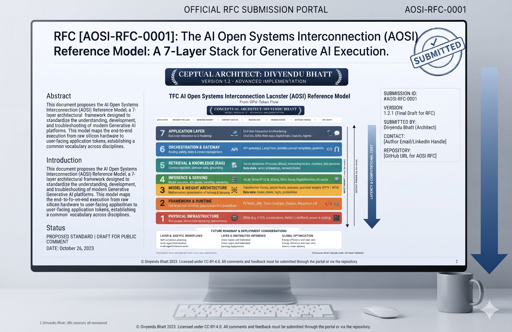

# **The AI Open Systems Interconnection (AOSI) Reference Model**

### **A 7-Layer Stack for Generative AI Execution (From GPU to Token Flow)**

**Author / Conceptual Architect:** Divyendu Bhatt · **Contact:** [github.com/CodingThrill0012](https://github.com/CodingThrill0012)
**Specification:** [AOSI-RFC-0001](rfc/RFC-0001-AOSI-Model.md) · **Version:** 1.2.1 (Final Draft for RFC) · **Status:** Proposed Standard | Draft for Public Comment
**License:** [CC-BY-4.0](LICENSE) · © Divyendu Bhatt



---

## **Table of Contents**

1. [Overview & Motivation](#1-overview--motivation)
2. [The 7-Layer Architecture Summary](#2-the-7-layer-architecture-summary)
3. [Repository Structure](#3-repository-structure)
4. [Quick Links & How to Participate in the RFC](#4-quick-links--how-to-participate-in-the-rfc)
5. [How to Cite](#5-how-to-cite)

---

## **1. Overview & Motivation**

### **1.1 The problem: a stack without a reference model**

A single generated token is the product of a long causal chain. A client submits a JSON request. A gateway applies templates, policy and conversation state. A retrieval pipeline injects grounding context. A serving engine tokenizes, schedules and batches the request against a shared KV cache. A transformer executes a forward pass over quantized weights. A framework and compiler lower that pass into fused kernels and collective operations. Finally, silicon performs multiply-accumulate operations, moving bytes across HBM and interconnect fabrics under power and thermal constraints.

Each segment of that chain is mature on its own terms, with its own vocabulary, telemetry and owners. Application teams talk about latency and prompts; MLOps teams talk about batch sizes and KV-cache hit rates; kernel engineers talk about occupancy and arithmetic intensity; infrastructure teams talk about HBM bandwidth, NVLink topology and rack power. **There is no shared, layered model that connects them.** The consequences are concrete:

- **Fault attribution is guesswork.** A slow response can originate in retrieval, in scheduler queueing, in KV-cache eviction, in a mis-fused kernel, or in memory-bandwidth saturation. Without layer boundaries, every incident becomes a cross-team investigation from first principles.
- **Interfaces are implicit.** The contracts between "the prompt", "the batch", "the graph" and "the device" are encoded in vendor-specific APIs rather than in stable, named abstractions.
- **Security and governance controls are mis-placed.** Prompt-injection defenses, data-poisoning controls, model-extraction mitigations and hardware side-channel concerns each belong to a different tier of the stack, yet are frequently discussed as a single "AI security" problem.
- **Vocabulary does not transfer.** Engineers moving between application, platform and hardware work lack a common frame for describing where a behaviour originates.

### **1.2 The proposal: an OSI-equivalent stack for generative AI**

The ISO/IEC OSI model gave networking a shared language: a fault could be described as "a Layer 2 problem" and every engineer understood the scope. **AOSI applies the same discipline to generative AI execution.** It decomposes the path from silicon math to application tokens into seven layers, each with:

- a defined **purpose and scope**,
- a canonical set of **core components**,
- a named **data state** that enters and leaves the layer,
- explicit **interfaces** to adjacent layers, and
- characteristic **observability signals** and **failure modes**.

The canonical data-state chain for a request travelling down the stack is:

```text
JSON Payload → Enriched Prompt → Vector Chunks → Batched Tensors → Hidden States → Tensor IR → Silicon Voltages
   (L7)            (L6)              (L5)            (L4)              (L3)           (L2)          (L1)
```

On the return path, the transformation inverts: device results become logits, logits become sampled token IDs, token IDs are detokenized, filtered and streamed back to the client as response chunks.

**Latency and computational cost increase toward the lower layers.** Upper layers dominate in semantic complexity and policy; lower layers dominate in FLOPs, bytes moved and watts consumed.

### **1.3 What AOSI is — and is not**

| Aspect | AOSI is | AOSI is not |
|---|---|---|
| **Nature** | A conceptual reference model and shared vocabulary | A protocol, a product or a reference implementation |
| **Scope** | Generative AI inference execution, end to end | A training methodology (training is addressed only where it shares layers) |
| **Vendor stance** | Technology-neutral; vendor tools are cited as examples | An endorsement of any vendor, framework or accelerator |
| **Use** | Architecture design, diagnostics, observability, security placement, education | A compliance certification |

---

## **2. The 7-Layer Architecture Summary**

Layers are listed from top (closest to the user) to bottom (closest to silicon). Normative definitions live in [AOSI-RFC-0001](rfc/RFC-0001-AOSI-Model.md).

| Layer | Name | Primary Function | Core Components (illustrative) | Data State |
|:---:|---|---|---|---|
| **L7** | **Application Layer** | End-user interaction and UI rendering | Chat UIs, IDEs, web apps, copilots, agents; OpenAI-compatible JSON APIs; SSE/WebSocket streaming clients | **JSON Payload** (API request in; streamed token/response chunks out) |
| **L6** | **Orchestration & Gateway** | Routing, safety, state and context management | API gateways, LangChain, LlamaIndex, prompt templates, guardrails, session/memory stores, rate limiters, model routers | **Enriched Prompt** (templated, policy-checked, stateful message sequence) |
| **L5** | **Retrieval & Knowledge (RAG)** | Context injection, semantic search, grounding | Vector DBs (e.g., Pinecone, Milvus), embedding models, chunkers, rerankers, hybrid (lexical + dense) search | **Vector Chunks** (vector embeddings and retrieved chunks merged into context) |
| **L4** | **Inference & Serving** | Model execution management, API caching, scheduling | vLLM, TensorRT-LLM, TGI, Triton Inference Server; PagedAttention, KV cache, continuous batching, speculative decoding, tokenizers | **Batched Tensors** (token-ID tensors, attention metadata, KV-cache block tables) |
| **L3** | **Model & Weight Architecture** | Mathematical representation of tokens and language | Transformer blocks, attention heads, MLP/MoE experts, activations, normalization, quantized weights (FP16/BF16/FP8/INT8/INT4) | **Hidden States** (hidden states → logits → probabilities) |
| **L2** | **Framework & Runtime** | Low-level math ops, graph compilation, parallelism | PyTorch, JAX, XLA/MLIR, Triton compiler, CUDA/ROCm, cuBLAS, FlashAttention kernels, NCCL/RCCL, DeepSpeed, Megatron-LM | **Tensor IR** (lowered graphs, fused kernels, collective schedules) |
| **L1** | **Physical Infrastructure** | Raw power, silicon math, interconnects | GPUs (e.g., H100), TPUs and other accelerators, HBM (e.g., HBM3e), NVLink/NVSwitch, InfiniBand/RoCE, power and cooling | **Silicon Voltages** (MAC operations, memory transactions, signalling, power draw) |

> **Axis note:** ↓ Latency and computational cost increase toward lower layers. ↑ Semantic abstraction and policy surface increase toward upper layers.

---

## **3. Repository Structure**

```text
aosi-model/
├── README.md                     # This landing page
├── CONTRIBUTING.md               # Community governance, review and amendment process
├── LICENSE                       # Creative Commons Attribution 4.0 International (CC-BY-4.0)
├── rfc/
│   └── RFC-0001-AOSI-Model.md    # AOSI-RFC-0001: the normative specification
├── assets/
│   ├── README.md                 # Conventions for diagrams and figures
│   └── aosi-rfc-0001-overview.png
└── diagnostics/
    └── README.md                 # Home for layer-specific runbooks, probes and dashboards
```

| Directory | Purpose |
|---|---|
| **`/rfc`** | Normative specifications. Each RFC is a single Markdown file named `RFC-NNNN-<Short-Title>.md`. Amendments are proposed per [CONTRIBUTING.md](CONTRIBUTING.md). |
| **`/assets`** | Diagrams, figures and source files (e.g., Mermaid, SVG, PNG) referenced by RFCs. Every asset must be traceable to the RFC section it illustrates. |
| **`/diagnostics`** | Practitioner material derived from the Diagnostic & Troubleshooting Matrix (RFC-0001 §7): runbooks, telemetry mappings, OpenTelemetry semantic attribute proposals and sample dashboards. |

---

## **4. Quick Links & How to Participate in the RFC**

### **4.1 Quick links**

| Resource | Link |
|---|---|
| **Specification** | [AOSI-RFC-0001 — The AOSI Reference Model](rfc/RFC-0001-AOSI-Model.md) |
| Layer definitions | [RFC-0001 §5 — Layer-by-Layer Specification](rfc/RFC-0001-AOSI-Model.md#5-layer-by-layer-specification) |
| Request lifecycle | [RFC-0001 §6 — Request Lifecycle Walk-Through](rfc/RFC-0001-AOSI-Model.md#6-request-lifecycle-walk-through) |
| Diagnostics ("Wireshark for AI") | [RFC-0001 §7 — Diagnostic & Troubleshooting Matrix](rfc/RFC-0001-AOSI-Model.md#7-diagnostic--troubleshooting-matrix) |
| Security | [RFC-0001 §8 — Security Considerations](rfc/RFC-0001-AOSI-Model.md#8-security-considerations) |
| Roadmap | [RFC-0001 §9 — Future Roadmap](rfc/RFC-0001-AOSI-Model.md#9-future-roadmap) |
| Related work | [RFC-0001 §10 — Related Work and Novelty](rfc/RFC-0001-AOSI-Model.md#10-related-work-and-novelty) |
| Citation metadata | [CITATION.cff](CITATION.cff) · [.zenodo.json](.zenodo.json) |
| Governance | [CONTRIBUTING.md](CONTRIBUTING.md) |
| Discussion | [GitHub Issues](https://github.com/CodingThrill0012/aosi-model/issues) |

### **4.2 How to participate**

AOSI-RFC-0001 is in its **public comment period**. Engineers, researchers and MLOps practitioners are invited to:

1. **Review** the specification, focusing on layer boundaries, data-state definitions and the diagnostic matrix.
2. **Comment** by opening a GitHub Issue using the appropriate type (`review-comment`, `clarification`, `erratum`, `layer-amendment`, `diagnostic-pattern`, `security`, `roadmap`).
3. **Propose amendments** to a layer's scope, components, interfaces or data states through the Layer Amendment Proposal (LAP) process.
4. **Debate** architectural questions in the open; decisions are recorded in the issue tracker with rationale.

Full guidelines are in **[CONTRIBUTING.md](CONTRIBUTING.md)**.

---

## **5. How to Cite**

If you use, extend or reference the AOSI Reference Model, please cite it as follows. Machine-readable metadata is in [`CITATION.cff`](CITATION.cff); GitHub's **"Cite this repository"** button uses it.

> **DOI:** a Zenodo DOI badge will be added here once the archived release exists.

**APA (7th ed.)**

```text
Bhatt, D. (2026). AOSI-RFC-0001: The AI Open Systems Interconnection (AOSI) Reference Model:
A 7-layer stack for generative AI execution (Version 1.2.1, Final Draft for RFC) [Proposed standard,
draft for public comment]. GitHub. https://github.com/CodingThrill0012/aosi-model
```

**BibTeX**

```bibtex
@techreport{bhatt2026aosi,
  author      = {Bhatt, Divyendu},
  title       = {{AOSI-RFC-0001}: The {AI} Open Systems Interconnection ({AOSI}) Reference Model: A 7-Layer Stack for Generative {AI} Execution},
  institution = {AOSI Model Repository},
  type        = {RFC},
  number      = {AOSI-RFC-0001},
  version     = {1.2.1},
  year        = {2026},
  month       = nov,
  note        = {Final Draft for RFC. Proposed Standard, Draft for Public Comment. Licensed under CC-BY-4.0},
  url         = {https://github.com/CodingThrill0012/aosi-model}
}
```

---

© Divyendu Bhatt. Licensed under [CC-BY-4.0](https://creativecommons.org/licenses/by/4.0/).
