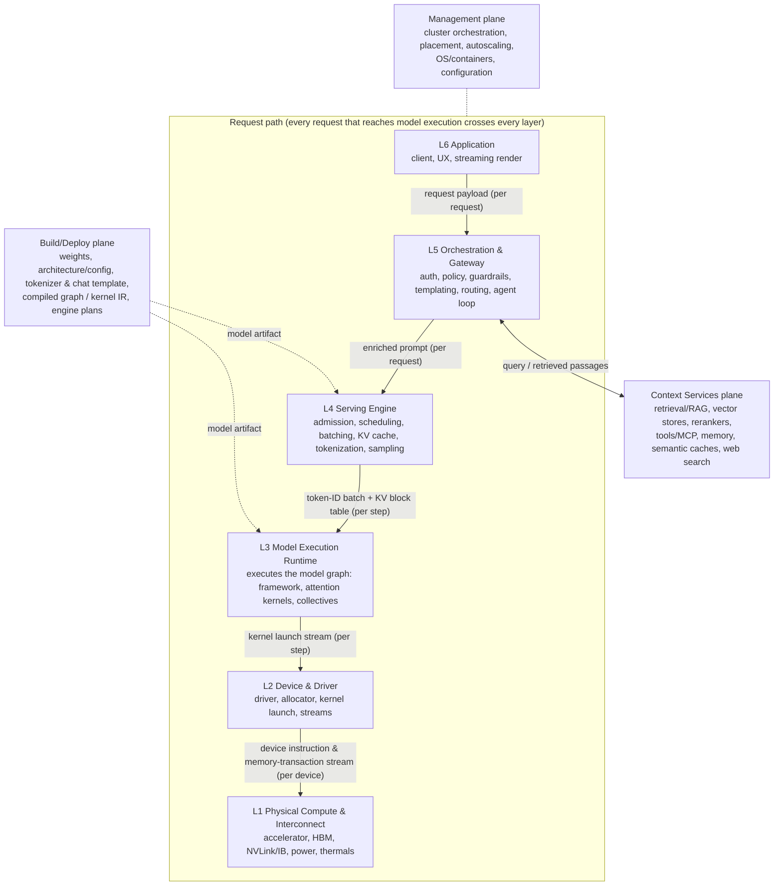
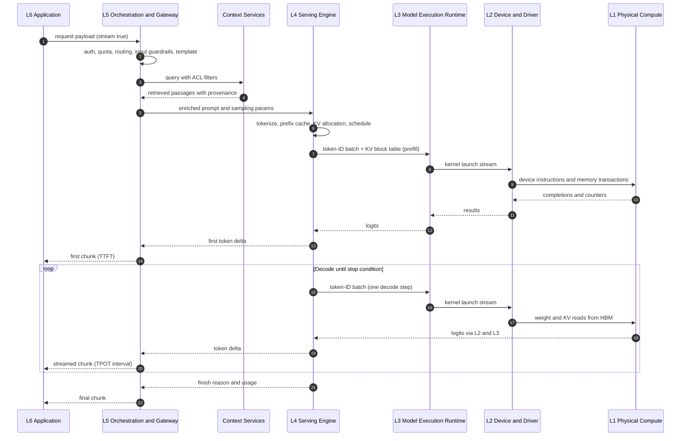
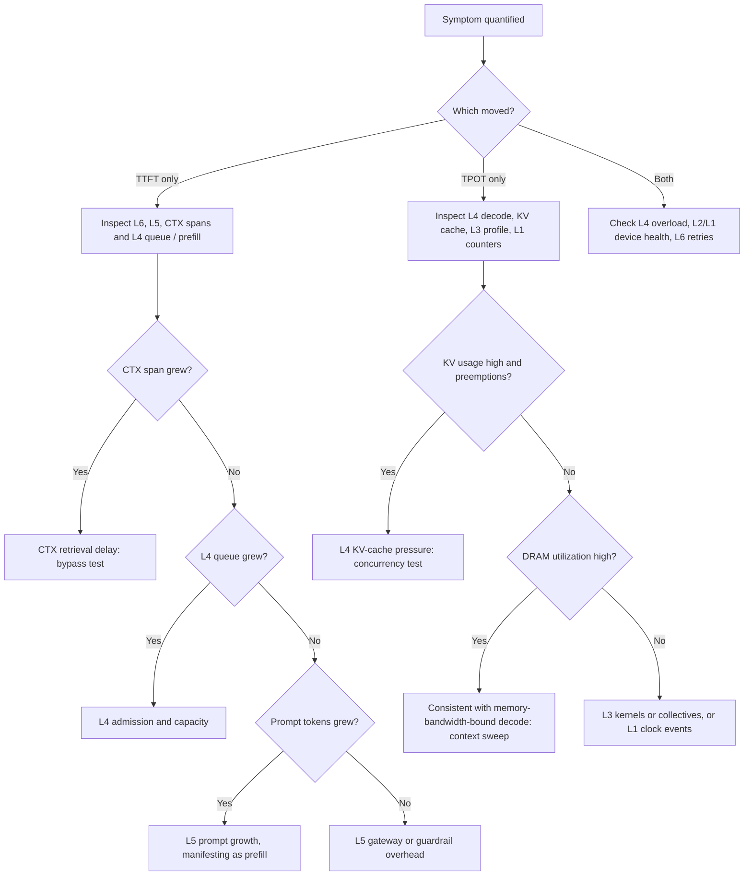

# DAIRM-TR-0001: DAIRM: Divyendu's Data-State-Aware AI Reference Model for Generative AI Inference Systems

| Field | Value |
|---|---|
| **Document ID** | DAIRM-TR-0001 |
| **Title** | DAIRM: Divyendu's Data-State-Aware AI Reference Model for Generative AI Inference Systems |
| **Version** | 2.0.0 |
| **Status** | Technical Report / Working Draft. Not an IETF RFC and not a standard. Published for public review. |
| **Publication status** | IETF Internet-Draft draft-bhatt-dairm-00 prepared, submission pending (not yet submitted; no RFC number; not an IETF standard). arXiv submission pending. |
| **Author** | Divyendu Bhatt (independent researcher) |
| **Contact** | Divyendu.bhatt@gmail.com · GitHub [@CodingThrill0012](https://github.com/CodingThrill0012) |
| **Repository** | https://github.com/CodingThrill0012/dairm |
| **Discussion** | https://github.com/CodingThrill0012/dairm/issues |
| **Date** | 2026-11-09 |
| **Supersedes** | AOSI v1.2.1 (2026-11-09, [doi:10.5281/zenodo.24073122](https://doi.org/10.5281/zenodo.24073122)) |
| **License** | Creative Commons Attribution 4.0 International (CC-BY-4.0) |

---

## Abstract

A generative AI request passes through a client application, an orchestration gateway, context services such as retrieval and tools, an inference-serving engine, a model-execution runtime, device drivers and accelerator hardware. Each tier has its own tools, telemetry and vocabulary, and it is often hard to say *where* a latency regression, a quality failure or a security threat originates.

This technical report describes **DAIRM**, *Divyendu's Data-State-Aware AI Reference Model*, an informative reference model for the **request path of generative AI inference serving**. DAIRM has three parts:

1. a **six-layer request path** (L6 Application, L5 Orchestration & Gateway, L4 Serving Engine, L3 Model Execution Runtime, L2 Device & Driver, L1 Physical Compute & Interconnect), with a **Context Services plane** called by orchestration, a **Build/Deploy plane** that supplies model artifacts and a **Management plane**;
2. a **named, observable data state at every boundary** of that path, from the request payload to device memory transactions and back as a token stream; and
3. a **boundary-attributed diagnostic method** with a layer-indexed telemetry attribute set (`dairm.*`) that separates context-service delay, serving-engine queueing and KV-cache pressure, and memory-bandwidth-bound decode.

DAIRM does not claim the layered-stack idea or the OSI analogy as new; several earlier OSI-inspired AI models exist and are credited in §10. DAIRM was first published as "AOSI" v1.2.1 and renamed in v2.0.0 to avoid confusion with an earlier, unrelated model of that name.

## Status of This Document

This is a **Technical Report / Working Draft**, version 2.0.0, published for public review. It is **not** an IETF RFC, it has not been adopted by any standards body, and it is not a standard. It is a single-author proposal. An IETF Internet-Draft version, draft-bhatt-dairm-00, has been prepared; its submission is pending (it has not yet been submitted, has no RFC number and is not an IETF standard). An arXiv submission of the companion paper is also pending. Comments, errata and change proposals are invited through the repository issue tracker under the process in [`CONTRIBUTING.md`](../CONTRIBUTING.md). The thresholds in §7 are illustrative and have not been measured.

---

## Contents

1. [Introduction](#1-introduction)
2. [Terminology and Notation](#2-terminology-and-notation)
3. [Design Principles](#3-design-principles)
4. [Architecture Overview](#4-architecture-overview)
5. [Layer and Plane Descriptions](#5-layer-and-plane-descriptions)
6. [Request Lifecycle](#6-request-lifecycle)
7. [Diagnostic Method](#7-diagnostic-method)
8. [Security Considerations](#8-security-considerations)
9. [Future Work](#9-future-work)
10. [Independent Development and Related Work](#10-independent-development-and-related-work)
11. [Applying the Model](#11-applying-the-model)
12. [AI-Assistance Disclosure](#12-ai-assistance-disclosure)
13. [Revision History](#13-revision-history)
14. [License and Citation](#14-license-and-citation)
- [Appendix A: Technology-to-Layer Mapping](#appendix-a-technology-to-layer-mapping)
- [Appendix B: Proposed Telemetry Attributes](#appendix-b-proposed-telemetry-attributes)

---

## 1. Introduction

### 1.1 The problem

Serving one generative request involves several engineering disciplines that are usually separated by team (application, platform, ML, infrastructure), by tooling (APM, MLOps dashboards, GPU profilers, data-center monitoring) and by vocabulary ("prompt", "batch", "graph", "kernel", "rail"). This causes four recurring problems:

1. **Non-attributable performance.** End-to-end latency is the sum of gateway work, context-service calls, queueing, prefill, decode, kernel execution and memory transfer. Without a decomposition, a regression in one tier shows up only as an aggregate symptom somewhere else.
2. **Implicit contracts.** What a "prompt" contains when it reaches the serving engine, what a "batch" hands to the runtime and what the runtime hands to the device are defined by individual products, not by a stable reference.
3. **Mis-located controls.** Security and governance controls are often specified as generic "AI controls" without stating the tier at which a threat materializes.
4. **Non-transferable expertise.** Engineers lack a common frame for saying *where* a behavior originates, which slows incident response and design review.

### 1.2 Contributions

Layered reference models such as the OSI Basic Reference Model [R1] showed the value of ordered layers with service boundaries and named data units. DAIRM borrows that *method*, not the OSI layers, and applies it to generative AI inference. It does not claim the layered-stack idea, the number of layers or the OSI analogy as new (§10). Its contributions are limited to three items:

1. **A named, observable data state at every boundary of the inference request path** (§4.3). Each state can be captured or measured. Above the serving engine a state is scoped to one request; from the serving engine down, where batching mixes requests, it is scoped to one scheduler step or device and is joined to its requests through a step identifier (`dairm.l4.step_id`). This makes each boundary a checkpoint for attributing cause.
2. **A boundary-attributed latency diagnostic method** (§7) that separates context-service delay, serving-engine queueing or KV-cache pressure, and memory-bandwidth-bound decode, using a latency decomposition, per-layer trace attribution and single-variable isolation tests.
3. **A layer-indexed telemetry attribute set** (`dairm.*`, Appendix B) that makes the method executable on OpenTelemetry traces and is designed to sit alongside the OpenTelemetry GenAI semantic conventions [R17].

The per-layer security mapping (§8, §10.5) is included as useful content, not as a claim of novelty; per-layer threat mapping already exists, for example in CSA MAESTRO [R22].

### 1.3 Scope

**In scope.** DAIRM models the **request path of generative AI inference serving**: from the client request to the hardware execution of each token, and back as a streamed response. It targets autoregressive transformer language models first, and multimodal models by extension.

**Out of scope.** Training, fine-tuning, data pipelines, evaluation and the model registry. They enter DAIRM only through the **Build/Deploy plane** (§5.8), as artifacts that the request path loads and executes. Federated learning is training and is out of scope.

**Named in the model but not detailed.** The following appear in the **Management plane** (§4.4) and are not layers of the request path: cluster and resource orchestration (e.g., Kubernetes, Ray, KServe; autoscaling, placement, model loading), operating system, virtualization and containers, and host CPU and PCIe configuration (for example, NUMA and PCIe topology settings). The PCIe fabric itself is an L1 interconnect (§5.6, Appendix A). The network between the client and the gateway is treated as part of the L6/L5 boundary transport; its internals are OSI's domain, not DAIRM's.

**Provider boundary.** For hosted model APIs, layers below the gateway are opaque to the consumer (§4.6).

### 1.4 What DAIRM is and is not

| Aspect | DAIRM is | DAIRM is not |
|---|---|---|
| Nature | An informative reference model and shared vocabulary | A protocol, a product, a certification or a standard |
| Scope | The request path of generative AI inference serving | A model of training or of the full ML lifecycle |
| Vendor stance | Technology-neutral; products are illustrative examples | An endorsement of any vendor, framework or accelerator |
| Claims | Boundary data states, boundary-attributed diagnostics, `dairm.*` attributes | The first layered or OSI-style model for AI |

---

## 2. Terminology and Notation

### 2.1 Requirements language

This document defines no protocol and uses no BCP 14 requirement keywords. The short **alignment checklist** in §11.2 lists what a description must contain to be called "DAIRM-aligned".

### 2.2 Terms

| Term | Definition |
|---|---|
| **Layer (Ln)** | A tier of the request path, L1 (closest to hardware) to L6 (closest to the user). Every request that reaches model execution passes through every layer; a request answered from a cache or rejected at L5 stops early. |
| **Plane** | A set of functions beside the request path. Planes are called by, or supply, layers but are not themselves on the path. DAIRM has three: Context Services, Build/Deploy and Management. |
| **Boundary** | The interface between two adjacent layers, written L5/L4, or between a layer and a plane, written CTX/L5. |
| **Data state** | The representation of a request or response as it crosses a boundary. It can be captured or measured at a stated **scope**: per request (L6/L5, CTX/L5, L5/L4 and the up-path), per scheduler step (L4/L3, L3/L2) or per device and sampling interval (L2/L1). Step- and device-scoped states are shared by the requests batched together and are joined to them by `dairm.l4.step_id` and `dairm.device_id`. |
| **Resident state** | Per-request state held in device memory across steps rather than handed between layers: activations (hidden states) and the KV cache. |
| **Artifact** | A build-time or deploy-time product loaded by the request path: weights, model architecture and configuration, tokenizer and chat template, compiled graph or kernel IR, kernels and engine plans. |
| **Down-path / up-path** | Request processing from L6 toward L1 / result processing from L1 toward L6. |
| **Prefill** | The forward pass over all prompt tokens that fills the KV cache and produces the first logits. Typically compute-bound. |
| **Decode** | The forward passes after prefill, one token per step (or several with speculative decoding). Usually memory-bandwidth-bound at the batch sizes common in serving, because each step reads the weights and KV cache for little arithmetic [R30]. |
| **KV cache** | Per-sequence storage of attention keys and values for prior tokens, managed by L4 and resident in device memory. |
| **TTFT** | Time to first token: request receipt to first output token delivered to the client. |
| **TPOT / ITL** | Time per output token: a request's mean decode time per output token, `(E2E − TTFT) / (N_out − 1)`. Inter-token latency: the distribution of individual gaps between successive output tokens, which exposes stalls that a mean hides. vLLM exports both [R29]; OpenTelemetry GenAI defines `gen_ai.server.time_per_output_token` [R17]. |
| **E2E latency** | Approximately `TTFT + (N_out − 1) × TPOT` for a streamed response. |
| **Goodput** | Throughput of requests that meet their latency SLOs. |
| **Span** | An OpenTelemetry unit of traced work. DAIRM-aligned tracing attributes each span to exactly one layer or plane. |
| **Compiled graph / kernel IR** | Any intermediate representation of a computation graph or kernel below the framework API (e.g., TorchFX/Inductor graphs, StableHLO, MLIR dialects, PTX). In DAIRM it is a Build/Deploy artifact, not a per-request data state. |
| **Provider boundary** | The boundary below which a hosted-API consumer cannot observe the system (§4.6). |

### 2.3 Notation

Layers are written **L1–L6**, planes **CTX** (Context Services), **BUILD** (Build/Deploy) and **MGMT** (Management). Thresholds called "illustrative" are examples for exposition, not recommended values.

---

## 3. Design Principles

1. **P1 Single responsibility per layer.** Each layer has one primary function. A product that spans layers (e.g., a serving engine with its own kernels) is described once for each layer it occupies.
2. **P2 Named, observable data state at every boundary.** Every boundary has a defined data state that can be captured, inspected or measured, per request or, where the serving engine batches requests, per scheduler step or device, and that can be joined to the requests it served. Metaphors and build-time artifacts do not qualify.
3. **P3 Adjacency of interfaces.** A layer interacts with its immediate neighbors and with the planes. Any other shortcut (e.g., an application pinning a GPU, or orchestration pre-tokenizing for budgeting) is documented as an explicit cross-layer coupling.
4. **P4 Observability by construction.** Each layer and plane emits telemetry at its boundaries that is attributable to it, so that §7 can be applied.
5. **P5 Technology neutrality.** Layer definitions do not depend on a vendor, framework or accelerator.
6. **P6 Where cost and latency sit.** Compute, data movement and energy concentrate in the lower layers. Semantic and policy complexity concentrate in the upper layers. Latency can originate at any layer, so it is attributed per boundary, not assumed.
7. **P7 Security at the point of materialization.** Controls are placed at the layer or plane where a threat materializes, with defense in depth elsewhere where justified.

---

## 4. Architecture Overview

### 4.1 The request path and the planes



*Solid arrows: down-path data states. The up-path returns logits → sampled token IDs → detokenized text deltas → streamed response chunks (§4.3). Dotted arrows: artifacts and management, which are not per-request data.*

A source-drawn version of this figure is in [`assets/dairm-overview.svg`](../assets/dairm-overview.svg), generated by [`assets/build_overview.py`](../assets/build_overview.py); the Mermaid source is also in [`assets/dairm-overview.mmd`](../assets/dairm-overview.mmd).

### 4.2 Summary table

| Layer | Name | Owns | Illustrative components |
|:---:|---|---|---|
| **L6** | Application | Client, UX, streaming render | Chat UIs, IDE assistants, web/mobile apps, SDKs, SSE/WebSocket clients |
| **L5** | Orchestration & Gateway | Auth, policy, guardrails, templating, routing, agent loop, tool and context-service calls | API/AI gateways, LangChain, LlamaIndex, guardrail frameworks, model routers, MCP/A2A clients |
| **L4** | Serving Engine | Admission, queueing, scheduling, continuous batching, KV-cache management, tokenization (executing the artifact's tokenizer), sampling | vLLM, TensorRT-LLM, Hugging Face TGI, NVIDIA Triton Inference Server, SGLang |
| **L3** | Model Execution Runtime | Executes the model graph: framework runtime, attention and GEMM kernels, collectives | PyTorch runtime, TensorRT-LLM runtime, FlashAttention, cuBLAS/CUTLASS, NCCL/RCCL |
| **L2** | Device & Driver | Driver, memory allocator, kernel launch, streams, device error reporting | CUDA/ROCm drivers and runtimes, CUDA Graphs replay, MIG partitioning |
| **L1** | Physical Compute & Interconnect | Accelerators, HBM, intra/inter-node fabric, power, thermals | H100-class GPUs, AMD Instinct, TPUs/ASICs, HBM3e, NVLink/NVSwitch, InfiniBand/RoCE |

| Plane | Holds |
|---|---|
| **CTX** Context Services | Retrieval/RAG, vector stores, embedding models, rerankers, tools/MCP servers, memory stores, semantic caches, web search |
| **BUILD** Build/Deploy | Model artifact (weights, architecture/config, tokenizer, chat template), compiled graph / kernel IR, engine plans, quantization format, artifact signing |
| **MGMT** Management | Cluster/resource orchestration, placement, autoscaling, model loading, OS/containers, configuration |

L2 and L1 are kept separate because the diagnostics distinguish driver and runtime faults (e.g., Xid-class errors, launch overhead, allocator fragmentation) from physical limits (bandwidth ceilings, clock-event reasons, thermal and power capping).

### 4.3 Boundary data states

This is the core of DAIRM. Each state can be captured or measured at the scope shown. Request-scoped states belong to one request. Step-scoped states (L4/L3, L3/L2) describe one scheduler iteration that serves every request in the batch, and the device-scoped state (L2/L1) is sampled per device and interval; both are joined to requests through `dairm.l4.step_id` (recorded on the request's L4 spans and on step records) and `dairm.device_id`. Caches can end the path early: a gateway response cache answers at L5, and a prefix-cache hit at L4 skips part of prefill, so not every request produces every state.

| Boundary | Data state | Scope | `dairm.data_state` | Observable as |
|---|---|---|---|---|
| L6 → L5 | **Request payload** (JSON/HTTP: messages, tools, sampling parameters, stream flag) | Request | `request_payload` | Request body, size, schema validity |
| CTX → L5 (return) | **Retrieved passages** (text plus scores and provenance). The query embedding stays inside the context service. | Request | `retrieved_passages` | Passage count, tokens contributed, source IDs |
| L5 → L4 | **Enriched prompt** (templated messages or text, tool schemas, sampling parameters, priority) | Request | `enriched_prompt` | Prompt tokens after enrichment |
| L4 → L3 | **Token-ID batch + KV-cache block table** (scheduled batch: token IDs, positions, sequence-to-block mappings) | Scheduler step | `token_batch` | Batch size, tokens per step, KV blocks used |
| L3 → L2 | **Kernel launch stream** (operator and kernel invocations with tensor arguments; activations and KV tensors stay resident in device memory) | Scheduler step | `kernel_stream` | Kernel traces (Nsight Systems, CUPTI), launch counts |
| L2 → L1 | **Device instruction & memory-transaction stream** | Device, per sampling interval | `device_stream` | Hardware counters: SM and tensor-pipe activity, DRAM/HBM bytes, NVLink bytes (DCGM, CUPTI) |
| Up-path | **Logits → sampled token IDs → detokenized text deltas → streamed response chunks** | Request | `token_stream` | ITL/TPOT per token, stream events |

**Resident state.** Hidden states (activations) and the KV cache are **resident device-memory state**. They are not messages handed from one layer to another; they are produced and consumed in place by L3 kernels executing on L1, under L4's block management.

**Artifacts are not data states.** Weights, model architecture, tokenizer, chat template and compiled graph / kernel IR are produced at build, compile or warm-up time (BUILD) and loaded by L4 and L3. They are drawn beside the path, not on it.

### 4.4 Planes

- **Context Services (CTX).** Called by L5 with a query and returning retrieved passages (or tool results) with scores and provenance. Retrieval keeps its own spans, metrics and diagnostics, attributed to CTX rather than to a layer. If a context service itself calls a serving engine (e.g., for embeddings or reranking), that call is a nested trace through L4–L1.
- **Build/Deploy (BUILD).** Produces and supplies artifacts. Training and fine-tuning sit upstream of this plane and are out of scope.
- **Management (MGMT).** Cluster and resource orchestration, placement, autoscaling, model loading, OS and containers, and configuration. Not per request.

### 4.5 Ownership rules for cross-layer concerns

| Concern | Owner | Notes |
|---|---|---|
| Tokenizer and chat template | BUILD (artifact), executed at L4 | L5 may pre-tokenize for budgeting; this is a documented cross-layer coupling (P3). |
| Quantization | Format stored in the BUILD artifact; selected at deploy time by L4 configuration; realized by L3 kernels | One owner per artifact: the artifact owns the format, L4 owns the selection, L3 owns the kernels. |
| KV cache | Managed by L4 (blocks, eviction, prefix reuse); computed by L3; held in L1 memory | KV precision is an L4 deploy choice realized by L3 kernels. |
| Agents | L5 (agent loop, planning, tool/function calling, MCP/A2A clients) | Tools and memory are exposed through CTX. Agents are not an L6 component and not a layer above L6. |

### 4.6 Provider boundary

When a consumer uses a hosted model API, L4–L1 (and often parts of L5) sit behind the provider boundary. What stays observable to the consumer:

- client-side TTFT and inter-token latency (L6),
- the consumer's own orchestration and context-service spans (L5, CTX),
- prompt and completion token usage returned by the API,
- any provider-reported latency, queue or cache fields.

The diagnostic method (§7) still applies with only these signals: decomposition separates the consumer's own L5/CTX time from time spent behind the provider boundary, and isolation tests (bypass context services, fix prompt length, vary concurrency) can show whether a regression is inside or outside the boundary, even if they cannot attribute it to a specific provider-side layer.

---

## 5. Layer and Plane Descriptions

Each layer is described by purpose and scope, components, data-state transformation, interfaces, observability signals and failure modes. Components are illustrative.

### 5.1 L6 Application

**Purpose and scope.** User interaction, request serialization and rendering of streamed output. L6 owns user experience, client-side session handling and presentation of results (including citations and tool outputs). Prompt construction belongs to L5.

**Components.** Chat UIs, IDE assistants, web and mobile apps; API clients and SDKs issuing OpenAI-compatible (or equivalent) JSON requests; streaming transports (SSE, WebSockets, gRPC streams); client rendering, partial-output handling and cancellation.

**Data-state transformation.** Down: user intent → **request payload**. Up: streamed response chunks → rendered output.

**Interfaces.** L6 → L5: HTTP(S)/gRPC request with the payload, end-user identity and session identifiers. L5 → L6: response chunks, `finish_reason`, usage and policy outcomes.

**Observability.** Client-perceived TTFT and ITL; time to render; error rate by status class; cancellation and abandonment rate; payload size; client span (`dairm.layer=6`).

**Failure modes.** Client timeouts shorter than server SLOs; buffering proxies that defeat streaming; malformed or oversized payloads; retry storms; rendering stalls misattributed to the model.

### 5.2 L5 Orchestration & Gateway

**Purpose and scope.** The policy enforcement point and the home of orchestration. L5 authenticates and authorizes the caller, enforces quotas, selects the model endpoint, applies templates and system policy, maintains conversation state, runs the **agent loop** (planning, tool/function calling, MCP/A2A clients), calls **Context Services** when grounding or tools are needed, and applies input and output guardrails.

**Components.** API and AI gateways (authentication, rate limiting, routing, failover, response caching); orchestration frameworks (LangChain, LlamaIndex and equivalents); prompt templates and system-prompt management; guardrails (input classifiers, PII redaction, prompt-injection detection, output moderation, structured-output validation); session stores; model routers; agent runtimes and MCP/A2A clients.

**Data-state transformation.** Down: **request payload** (+ **retrieved passages** from CTX) → **enriched prompt**. Up: detokenized text deltas from L4 → policy-filtered, schema-validated response chunks.

**Interfaces.** L5 → CTX: query (raw or rewritten), tenant/ACL filter, top-k, budget. CTX → L5: retrieved passages or tool results with scores and provenance. L5 → L4: enriched prompt, sampling parameters, priority/SLO class. L4 → L5: token/text stream, usage, finish reason.

**Observability.** Gateway overhead; guardrail latency (input and output); routing decisions; response-cache hit rate; refusal and policy-violation rates; prompt tokens after enrichment; agent steps per request; span `dairm.layer=5` with child spans per guardrail, template and agent step.

**Failure modes.** Prompt bloat from unbounded history (pushing load onto L4 prefill); guardrail latency dominating TTFT; output moderation that buffers the stream; routing to an overloaded endpoint; template mismatch with the artifact's chat template; prompt injection passing policy checks; runaway agent loops.

### 5.3 L4 Serving Engine

**Purpose and scope.** Model execution as a service: admission, queueing, scheduling, continuous (iteration-level) batching, KV-cache management, prefix caching, tokenization and detokenization (executing the artifact's tokenizer) and sampling. L4 turns many independent prompts into a sequence of batched forward passes executed by L3.

**Components.** vLLM, TensorRT-LLM, Hugging Face TGI, NVIDIA Triton Inference Server and equivalents; schedulers (iteration-level batching [R26], chunked prefill [R27], priority and preemption, prefill/decode disaggregation [R28]); KV-cache managers (PagedAttention [R10], prefix caching, eviction/swap); speculative and constrained decoding; deploy-time configuration (parallel degrees, quantization selection, KV precision).

**Data-state transformation.** Down: **enriched prompt** → **token-ID batch + KV-cache block table**. Up: logits → sampled token IDs → detokenized text deltas.

**Interfaces.** L5 → L4: prompt, sampling parameters, max tokens, priority. L4 → L3: per-iteration batch and block table. L3 → L4: logits (or sampled tokens when sampling is fused).

**Observability.** Queue time; server-side TTFT; TPOT/ITL; prefill and decode throughput; running and waiting requests; KV-cache usage; prefix-cache hit rate; preemptions; batch size per iteration; speculative-decoding acceptance; span `dairm.layer=4` with child spans `queue`, `prefill`, `decode`. Engine metric names vary by product and version; for example, current vLLM documentation lists `vllm:time_to_first_token_seconds`, `vllm:inter_token_latency_seconds`, `vllm:kv_cache_usage_perc` (formerly `gpu_cache_usage_perc`), `vllm:num_requests_waiting` and `vllm:num_preemptions` [R29].

**Failure modes.** KV-cache exhaustion leading to preemption, recomputation or swapping, and therefore TPOT spikes; head-of-line blocking from long prefills; over-batching beyond SLO; low prefix-cache hit rate from non-deterministic L5 prefixes; tokenizer or chat-template mismatch with the artifact.

### 5.4 L3 Model Execution Runtime

**Purpose and scope.** Executes the model graph supplied by BUILD for each scheduled batch: embedding lookup, transformer blocks (attention, MLP or mixture-of-experts, normalization) and the output projection, as framework operators and kernels, plus collective communication when the model is sharded. L3 is where the model artifact *runs*; the artifact itself is not a layer.

**Components.** Framework runtimes (PyTorch eager or compiled, JAX), inference runtimes (e.g., the TensorRT-LLM runtime, ONNX Runtime), kernel libraries (cuBLAS/cuBLASLt, CUTLASS, FlashAttention [R25], ROCm equivalents), collective libraries (NCCL, RCCL).

**Data-state transformation.** Down: **token-ID batch + block table** → **kernel launch stream**; activations and KV tensors are produced in place as resident state. Up: kernel results → logits for L4.

**Interfaces.** L4 → L3: batch and block table. L3 → L2: kernel launches, memory copies, collectives. L2 → L3: completion events and errors.

**Observability.** Kernel time breakdown (GEMM, attention, communication); CPU-side launch gaps; achieved occupancy and arithmetic intensity (roofline position [R30]); collective time and overlap; recompilation events; numerical health of logits (NaN/Inf, entropy). Tools: Nsight Systems/Compute, PyTorch Profiler, XLA profilers.

**Failure modes.** Recompilation or graph breaks causing jitter; unfused kernels; launch-bound execution at small batch; collective stalls from topology-unaware placement; numerical instability in low precision; MoE expert imbalance.

### 5.5 L2 Device & Driver

**Purpose and scope.** The driver and device runtime: memory allocation, kernel launch and streams, graph replay, device partitioning and error reporting.

**Components.** CUDA and ROCm drivers and runtimes; device allocators; CUDA Graphs replay; MIG and other partitioning.

**Data-state transformation.** Down: **kernel launch stream** → **device instruction & memory-transaction stream**. Up: completion events, error codes and counters.

**Interfaces.** L3 → L2: launches, copies, collectives. L2 → L1: device instructions, DMA, link traffic. L1 → L2: completions, interrupts, error signals, counters.

**Observability.** Launch overhead; allocator fragmentation and out-of-memory events; Xid-class errors (e.g., `DCGM_FI_DEV_XID_ERROR`); driver resets.

**Failure modes.** Driver/runtime version incompatibility; out-of-memory despite free capacity (fragmentation); device resets; noisy neighbors under partitioning.

### 5.6 L1 Physical Compute & Interconnect

**Purpose and scope.** The accelerators that execute instructions, the memory hierarchy that feeds them, the intra- and inter-node fabrics that connect them, and the power and thermal envelope that limits them.

**Components.** GPUs, TPUs and other AI accelerators; HBM, on-chip SRAM, host memory, NVMe tiers for offload; NVLink/NVSwitch, PCIe, InfiniBand, RoCE; power delivery and cooling.

**Data-state transformation.** Down: the **device instruction & memory-transaction stream** is executed and is observable only as **hardware counters** (SM and tensor-pipe activity, DRAM/HBM bytes, link bytes), power and temperature. Up: results in device memory and counters exposed to L2.

**Observability.** DCGM profiling and device fields such as `DCGM_FI_PROF_SM_UTIL_RATIO`, `DCGM_FI_PROF_TENSOR_UTIL_RATIO`, `DCGM_FI_PROF_DRAM_UTIL_RATIO`, `DCGM_FI_PROF_NVLINK_TX_BYTES`, `DCGM_FI_DEV_CLOCKS_EVENT_REASONS` and `DCGM_FI_DEV_GPU_TEMP` [R31]. These names are from the DCGM field-ID documentation as accessed on 9 Nov 2026; earlier DCGM versions used other names (e.g., `*_ACTIVE`, "throttle reasons"), so pin the DCGM version when relying on exact names.

**Failure modes.** Memory bandwidth usually bounds decode speed [R30]; that is a workload property, not a fault, and becomes a failure only when it breaks an SLO. Faults include thermal or power capping reducing clocks; link degradation; ECC and hardware faults; capacity exhaustion forcing offload to slower tiers.

### 5.7 Context Services plane (CTX)

**Purpose and scope.** Supplies context and capabilities to L5 by call and return: retrieval/RAG [R24], vector stores and ANN indexes, embedding models and rerankers, tools and MCP servers, memory stores, semantic caches and web search. Index construction (ingestion, chunking, write-time embedding) belongs to the data pipeline and is referenced only at its interface.

**Data-state transformation.** Query (text plus filters) → internal query embedding and candidate set → **retrieved passages** (text, score, source URI, version, ACL tag) returned to L5.

**Observability.** Embedding latency; ANN search latency (p50/p95/p99); rerank latency; tool-call latency and error rate; recall@k or nDCG against an evaluation set; empty-result rate; tokens contributed to the prompt; index freshness; span `dairm.plane=context_services` with `dairm.ctx.service`.

**Failure modes.** Retrieval lag (index not memory-resident, cold caches, remote hops); low recall from embedding or chunking mismatch; context dilution from excessive k; stale index; cross-tenant ACL leakage; poisoned documents; slow or failing tools.

### 5.8 Build/Deploy plane (BUILD)

**Purpose and scope.** Produces and supplies the artifacts that L4 and L3 load: weights and their format (FP16/BF16/FP8/INT8/INT4, adapters such as LoRA), model architecture and configuration (e.g., attention variant, RoPE scaling, context length), tokenizer and chat template, compiled graph / kernel IR (e.g., `torch.compile` output, TensorRT engine plans, XLA executables) and kernel selections. Compilation may happen ahead of time or at warm-up; either way the result is an artifact, not per-request data.

**Observability.** Artifact identity and digest (`dairm.artifact.id`), quantization format, build and compile time, warm-up and recompilation events, evaluation deltas against a reference precision.

**Failure modes.** Architecture/configuration mismatch with serving (e.g., wrong RoPE scaling or chat template); quality regression from aggressive quantization; tampered or unsigned artifacts; stale compiled plans after a driver or runtime upgrade.

---

## 6. Request Lifecycle

### 6.1 Down the path: ingestion, context and prefill

1. **L6** issues a request payload with `stream: true`.
2. **L5** authenticates, enforces quota, selects an endpoint, runs input guardrails, loads session history, applies the template and decides grounding is needed.
3. **CTX** embeds the query, searches the index with tenant ACL filters, reranks and returns retrieved passages with provenance. L5 builds the **enriched prompt**.
4. **L4** tokenizes, checks the prefix cache, allocates KV blocks and admits the sequence into the next iteration, forming a **token-ID batch + block table**.
5. **L3** executes the prefill forward pass as a **kernel launch stream**; activations and KV entries are written in place in device memory.
6. **L2** launches kernels and copies; **L1** executes them, observable as **hardware counters**. Prefill is mostly compute-bound.

### 6.2 Up the path: decode and streaming

7. **L3 → L4.** Logits for the last position are returned; L4 samples the first token. TTFT is fixed here, plus up-path transit.
8. **L4 → L5 → L6.** The token is detokenized and streamed through output guardrails to the client.
9. **Decode loop.** For each further token, L4 schedules a decode iteration; L3 runs a one-token forward pass that reads the weights and the KV cache from device memory. At the batch sizes common in serving, decode is usually memory-bandwidth-bound [R30], so TPOT depends largely on L4 batching and KV behavior, L3 attention-kernel cost (which grows with context) and L1 memory bandwidth.
10. **Completion.** L4 frees or retains KV blocks for prefix reuse, L5 records usage and policy outcomes, L6 renders the final state.

### 6.3 Sequence diagram



---

## 7. Diagnostic Method

### 7.1 Boundary-attributed tracing

The method works by decomposition rather than intuition: **every request should produce a trace in which each span is attributed to exactly one layer or plane, and each boundary hand-off is timestamped.** In practice, a DAIRM-aligned deployment:

1. propagates one trace context (W3C Trace Context [R18], e.g., via OpenTelemetry) from L6 through L4 and into CTX calls;
2. tags every span with `dairm.layer` or `dairm.plane` and `dairm.data_state` (Appendix B), alongside OpenTelemetry GenAI attributes such as `gen_ai.operation.name`, model name and token usage [R17] (those conventions are at Development stability);
3. exports L4 engine metrics [R29] and L1 device metrics [R31] on a common time base, labeled with node, device and replica identifiers, so that spans can be joined to device telemetry; and
4. captures L3 profiles on demand for representative requests.

### 7.2 Latency decomposition

```text
E2E  ≈ TTFT + (N_out − 1) × TPOT

TTFT ≈ t_L6_client + t_L5_gateway + t_L5_guardrails_in + t_CTX
       + t_L4_queue + t_L4_tokenize + t_prefill(L3/L2/L1) + t_up_first_token

TPOT ≈ t_L4_schedule_iteration + t_decode_step(L3/L2/L1) + t_L5_guardrails_out_per_chunk
```

How to read it:

- **TTFT inflated, TPOT normal.** The cause is upper-layer time (L5 gateway or guardrails, CTX calls), **or** L4 queueing, **or** prefill compute for longer prompts. Separate them with the L5 and CTX spans, the L4 `queue` span versus the `prefill` span, and the prompt-token count at L5/L4.
- **TPOT inflated, TTFT normal.** Look at L4 decode (KV-cache pressure, preemption, batch growth), L3 kernels (attention cost grows with context; collective stalls), L1 (memory bandwidth, clock events) or buffering output guardrails at L5.
- **Both inflated.** Systemic causes: overload (L4 queue), device degradation (L2/L1) or retry storms (L6).

### 7.3 Separating context-service delay, KV-cache pressure and memory-bandwidth-bound decode

These three causes are often confused because each looks like "the model is slow". The signatures below follow from mechanism [R10][R30]; thresholds are **illustrative** and must be calibrated per deployment.

| Discriminator | **CTX retrieval delay** | **L4 KV-cache pressure** | **Memory-bandwidth-bound decode (L1, workload property)** |
|---|---|---|---|
| Latency signature | TTFT up; TPOT unchanged | TPOT up and spiky; TTFT up if admission blocks | TPOT up smoothly with batch size and context length |
| Where time sits in the trace | CTX span (embed / search / rerank) grows before any L4 span | L4 `queue` span grows; decode shows preemption or recompute gaps | L4 `decode` span grows uniformly per step; no extra queueing |
| L4 engine metrics | Normal queue and KV usage | KV usage near capacity; preemptions rising; waiting requests rising | KV usage may be moderate; running batch large; tokens/s per device plateaus |
| L1 device metrics | Normal | Not necessarily saturated; utilization may drop during preemption churn | DRAM utilization ratio persistently high during decode; tensor-pipe utilization comparatively low |
| Isolation test | Replay with CTX bypassed and an equal-length fixed context: TTFT recovers → CTX implicated | Replay with lower concurrency (e.g., `max_num_seqs`) or a larger KV budget: spikes disappear → L4 implicated | Sweep context length at fixed batch size, and batch size at fixed context length: TPOT tracks bytes read per step while DRAM utilization stays high → **consistent with** memory-bandwidth-bound decode |
| Illustrative trigger | CTX span p95 > 30% of TTFT | KV usage > 90% with non-zero preemptions per minute | DRAM utilization ratio > 0.8 sustained during decode |
| Remediate at | CTX: keep the index memory-resident, co-locate, cache query embeddings, lower k or rerank depth; L5: parallelize CTX calls | L4: prefix caching, KV quantization, admission limits, a larger KV budget, more replicas (chunked prefill and disaggregation address prefill interference, not KV capacity) | BUILD/L4: weight or KV quantization, speculative decoding, GQA/MQA models; MGMT: scale out; L1: higher-bandwidth parts |

**Caution on the third column.** TPOT growth with context length is also caused by attention-kernel cost at L3 and by KV reads, so the sweeps show behavior *consistent with* memory-bandwidth-bound decode; it does not by itself prove an L1 fault. High memory-bandwidth use during decode is usually a property of the workload's arithmetic intensity, not a hardware defect.

### 7.4 Troubleshooting matrix

| # | Symptom | Suspected layer/plane | Telemetry / tool | Isolation test | Remediation |
|:---:|---|:---:|---|---|---|
| 1 | Response arrives all at once despite `stream: true` | L6 / L5 | Client first byte vs first rendered chunk; proxy logs | Call L5 directly, bypassing CDN/proxy | Disable proxy buffering; streaming-compatible output guardrails |
| 2 | Client timeouts while server reports success | L6 | Client vs server span durations | Compare client timeout with server p99 E2E | Align timeouts with SLO; propagate cancellation |
| 3 | TTFT high with constant overhead for all prompts | L5 | Gateway and guardrail spans | Disable the guardrail chain on a test route | Parallelize guardrails; smaller classifiers; cache verdicts |
| 4 | Prompt tokens grow with each turn | L5 | Enriched-prompt token count per request | Replay with history truncated | Summarization, windowing, memory via CTX |
| 5 | TTFT high only for grounded requests | CTX | CTX span breakdown (embed / search / rerank) | Replay with CTX bypassed (§7.3) | Index residency, co-location, embedding cache, lower k |
| 6 | Grounded answers cite wrong or stale sources | CTX | Recall@k on a known-answer set; index freshness | Query the known-answer set | Re-chunk, re-embed, refresh index, add reranker |
| 7 | TTFT high under load, low at idle | L4 | `queue` span; waiting-request gauge | Replay at lower concurrency | Autoscale (MGMT); priority classes; admission control |
| 8 | Intermittent TPOT spikes | L4 | KV usage; preemption counters | Lower concurrency or larger KV budget (§7.3) | Prefix caching, KV quantization, admission limits, larger KV budget |
| 9 | Low prefix-cache hit rate despite a shared system prompt | L5 → L4 | Prefix-cache hit rate; prompt diffs | Compare tokenized prefixes | Deterministic templates; variable content after the shared prefix |
| 10 | Quality regression after deployment, latency fine | BUILD | Eval deltas; logit entropy; quantization format | A/B against a reference-precision artifact | Revisit quantization; verify chat template and RoPE scaling |
| 11 | NaN or garbage output on long contexts | L3 / BUILD | Logit NaN/Inf checks; activation statistics | Same input at higher precision | Precision changes for unstable ops; verify context-length configuration |
| 12 | Latency jitter after a framework or engine upgrade | L3 / BUILD | Recompilation logs; Nsight Systems timeline | Warm up and replay with fixed shapes | Remove graph breaks; shape bucketing; rebuild plans |
| 13 | Low device utilization at small batch, high latency | L3 / L2 | Nsight Systems: CPU launch gaps | Profile one decode step | CUDA Graphs; kernel fusion; larger effective batch |
| 14 | Multi-device replica slower than expected | L3 / L1 | NCCL timing; NVLink/IB counters | Collective benchmarks (e.g., nccl-tests) | Topology-aware placement (MGMT); adjust parallel degrees; fix links |
| 15 | TPOT rises smoothly with batch and context | L1 (workload) / L3 | DCGM DRAM and tensor utilization ratios | Context sweep at fixed batch, batch sweep at fixed context (§7.3) | Quantization; speculative decoding; scale-out |
| 16 | Throughput drops after sustained load | L1 | Power vs cap; temperature; clock-event reasons | Correlate the drop with clock events | Cooling; power-cap policy; load spreading |
| 17 | Sporadic failures on one node | L2 / L1 | Xid and ECC counters; driver logs | Drain the node and run DCGM diagnostics | Reset or replace the device; exclude the node |

### 7.5 Triage procedure

Attribute top-down, confirm bottom-up:

1. **Quantify the symptom** as a change in TTFT, TPOT, E2E, error rate, goodput or quality, with percentile and window.
2. **Decompose** (§7.2): did TTFT, TPOT or both move?
3. **Walk the trace top-down** (L6 → L5/CTX → L4) against a baseline. The first layer or plane whose span distribution shifted is the **candidate**.
4. **Check the boundary data state** entering the candidate (prompt tokens at L5/L4, passages and tokens contributed at CTX/L5, batch size at L4/L3). As a **heuristic**, not a rule: if the incoming state changed, suspect the layer *above*, even if the time is spent below; if it did not, suspect the candidate. Contention from co-located work or a degraded lower layer can lengthen a span with an unchanged input, so steps 5–7 always follow.
5. **Correlate with lower-layer telemetry** (L4 metrics → L3 profiles → L2/L1 counters), joined on time, replica, node and device.
6. **Run the isolation test**, changing one variable.
7. **Confirm bottom-up** that the lower layers are healthy under the test.
8. **Remediate at the owning layer or plane**, then re-measure the original symptom.
9. **Record** the incident with its DAIRM attribution (root-cause layer and manifestation layer).



### 7.6 A small measured study (CPU only)

The procedure above was encoded as an automated triage and tested on a real, instrumented CPU-only stack: llama.cpp `llama-server` b12239 (L4, with its CPU backend as L3–L1) serving Qwen2.5-0.5B-Instruct Q4_K_M, a Python L5 gateway, an HTTP retrieval service (CTX) and a closed-loop L6 client, all emitting OpenTelemetry spans with `dairm.*` attributes. Five conditions (no fault; a 1000 ms CTX delay; full conversation history at L5; 1 instead of 4 engine slots at L4; busy-loop contention on the engine's cores, standing in for L2/L1) were each run for 24 requests in 3 repetitions against a per-repetition baseline, with thresholds fixed in code before the reported run.

Measured on 2026-11-10 (8-vCPU VM, no GPU): the triage attributed the root cause correctly in **15 of 15** condition-repetitions (12 of 12 faults, 3 of 3 no-fault controls), and the isolation test it selected confirmed all 12 fault attributions. In 6 of the 12 fault runs the first span that moved was at L4 although the fault was at L5 or below L4; the L5/L4 boundary state (median enriched-prompt tokens 288 at baseline vs 1118 under the history fault) and the host stall signal corrected those attributions.

The study does **not** test the KV-pressure or memory-bandwidth discriminators of §7.3 (no KV or DCGM-style counters on this stack), cannot separate L3, L2 and L1, uses one small model and a synthetic workload, and was designed and scored by the author after two pilots that adjusted fault sizes. Code, raw data, figures and limitations: [`eval/`](../eval/README.md).

---

## 8. Security Considerations

DAIRM places each threat at the layer or plane where it materializes (P7); controls elsewhere provide defense in depth. This mapping is content, not a novelty claim.

| Layer / plane | Principal threats | Representative controls |
|---|---|---|
| **L6** | Direct prompt injection and jailbreak attempts; session hijacking; abuse; leakage of output to unauthorized users | End-user authentication; input size limits; abuse detection; rendering that never executes untrusted content |
| **L5** | Prompt injection (direct, and indirect via tool or retrieved content [R32]); system-prompt disclosure; insecure tool invocation and excessive agency; quota bypass; cross-tenant state leakage | Policy enforcement point with input/output guardrails; separation of system, user and retrieved content; least-privilege tool scopes; human approval gates; per-tenant isolation; audit logging |
| **CTX** | Corpus or index poisoning; injected instructions in documents; ACL bypass; embedding inversion recovering source text from vectors [R33]; malicious tools | Ingestion provenance and integrity checks; server-side ACL filtering; content scanning; access control and encryption for vector stores; tool allow-lists |
| **L4** | Model extraction by high-volume querying; cross-request leakage through shared prefix or KV caches via timing side channels [R34]; denial of service via long prompts or unbounded generation | Rate limiting and anomaly detection; per-tenant cache isolation where confidentiality requires it; token and time budgets; log-probability exposure policy |
| **L3** | Unsafe deserialization of model files; compromised kernels or runtime libraries | Safe formats (e.g., safetensors); pinned, verified dependencies and SBOMs |
| **L2** | Driver or firmware compromise; residue between tenants under partitioning | Firmware attestation and updates; memory scrubbing between tenants; hardware partitioning |
| **L1** | Hardware side channels (timing, power); physical access | Dedicated devices or partitioning; confidential-computing capabilities where available; physical security |
| **BUILD** | Backdoored or tampered weights; supply-chain compromise of frameworks and compilers; membership inference and training-data extraction | Signed, hash-verified artifacts; provenance attestation; isolated build pipelines; red-team evaluation before promotion |

A DAIRM-aligned description should state, per layer and plane, which threats are in scope and which controls apply, and should not rely on one layer (e.g., L5 guardrails alone) as the only control for threats that materialize in CTX, BUILD or below L5.

The telemetry in §7 and Appendix B can itself expose sensitive information (prompt sizes, tenant identifiers, retrieval provenance, and timing that may help side-channel inference). Apply the same access control and data minimization to telemetry as to the request data it describes.

---

## 9. Future Work

Version 1.2.1 reserved "Layer 8" and "Layer 9" above the stack. These are **removed** in v2.0.0. Cisco Research has proposed "L8 Agent Communication" and "L9 Agent Semantic" layers above the OSI model (Fleming et al., arXiv:2511.19699 [R21]), and reusing those numbers would cause confusion. Agentic workflows are modeled inside L5 and CTX instead. Planned work:

1. **Agent traces.** Model multi-step agent executions as repeated passes through the request path, with a parent L5 span per plan and child spans per step, tool call and model call.
2. **Distributed and disaggregated inference.** Model prefill/decode disaggregation and multi-node serving inside L4–L1, adding an **inter-node KV-transfer** boundary state.
3. **A training/build view.** A separate view for training, fine-tuning and evaluation that meets the request path at the BUILD artifact.
4. **Global optimization metrics.** Measures such as energy per output token and goodput per watt, with feedback from L1 telemetry to L4/L5 control decisions.
5. **GPU case study.** A vLLM deployment on GPUs with DCGM, a RAG service and OpenTelemetry traces tagged `dairm.layer`, with injected faults (slow retrieval, KV-cache pressure, bandwidth-bound decode), measuring whether §7.3 attributes each fault correctly and reporting measured thresholds. A small CPU-only study of the procedure is in §7.6 and `eval/`; it cannot test the bandwidth discriminator.

---

## 10. Independent Development and Related Work

### 10.1 Independent development

DAIRM was developed independently by the author. A review of related work after the first public release (as "AOSI", v1.2.1, 9 Nov 2026) identified several earlier OSI-inspired layer models for AI. These include:

- **Reilly**, "AOSI (AI Open Systems Interconnection) Reference Model" (GitHub `kahalewai/aosi`, 28 Dec 2025) [R19], which uses the same name and a seven-layer framing with different layers;
- **Liang**, a seven-layer AI compute model from hardware to application (arXiv:2508.21394, Aug 2025) [R20];
- **Rodrigo-Ginés**, an OSI-inspired stack for agentic AI (Zenodo, Sep 2025) [R16];
- **Cisco Research**, proposed agent layers L8/L9 above OSI (Fleming et al., arXiv:2511.19699, Nov 2025) [R21];
- **CSA MAESTRO**, a seven-layer threat model for agentic AI (Feb 2025) [R22].

To avoid confusion with Reilly's work, this model was renamed DAIRM in v2.0.0. DAIRM does not claim the layered-stack idea or the OSI analogy as novel, and it does not claim priority over any of these works. Its contributions are (1) a named, observable data state at every boundary of the inference request path, (2) a boundary-attributed latency diagnostic method that separates context-service delay, serving-engine queueing/KV-cache pressure, and memory-bandwidth-bound decode, and (3) a layer-indexed telemetry attribute set (`dairm.*`) that makes the method executable on OpenTelemetry traces.

### 10.2 Other layered and OSI-inspired AI models

| Work | What it layers | Relation to DAIRM |
|---|---|---|
| Reilly, AOSI [R19] | 7 layers: Infrastructure, Model, Data, Orchestration, Communication, Interface, Application | Same former name and OSI framing; different layers; states what each layer provides to the one above but defines no per-request boundary data states or diagnostic method. |
| Liang [R20] | 7-layer AI compute model: Physical, Link, Neural Network, Context, Agent, Orchestrator, Application | Same hardware-to-application span with different cuts; covers KV cache and disaggregation inside layers; no boundary data states or diagnostic method. |
| Rodrigo-Ginés [R16] | 7-level interoperability stack for agentic AI | Concerned with interoperability between agents; DAIRM covers the inference path within one request. |
| Fleming et al. (Cisco) [R21] | L8 Agent Communication and L9 Agent Semantic layers above OSI | The reason DAIRM dropped its own L8/L9 roadmap; agent communication is outside DAIRM's scope. |
| CSA MAESTRO [R22] | 7-layer threat-modeling framework for agentic AI | Per-layer threat mapping predates DAIRM's; DAIRM's security table (§8) is content, not a novelty claim. |
| Chander, seven-layer map [R23] | 7 OSI-modeled layers for how LLMs work, including data and training | Places RAG inside orchestration and argues that training and serving need separate views; DAIRM adopts both points (CTX and BUILD planes). |
| Logan Smith, AI Layer Model [R35] | 9 layers in Substrate, Cognition and Systems planes | OSI-inspired responsibility map for placing AI components; found during DAIRM's name check; no per-request boundary states or latency diagnostics. |
| Darling (Dollhouse Research), AILIS v0.2.0 [R36] | 16+ layer vocabulary from facilities to application | Finer-grained map of AI system concerns; asks adopters to name the hand-offs between layers but defines none itself. DAIRM is narrower (the inference request path) and defines boundary states and diagnostics. |
| Localis, "AI OSI Model" [R37] | 7-layer AI technology-stack taxonomy | Name-level similarity to the former name; a taxonomy rather than a request-path model. |
| {a}OS, "The OSI Model for AI" [R38] | 7 strata, including a separate knowledge and memory stratum | Agent-centric; DAIRM treats retrieval and memory as a context-services plane. |
| Shapiro et al., ACE [R15] | 6-layer cognitive architecture for autonomous agents | Layers agent reasoning, not the execution path. |
| Bucaioni et al. [R39] | Functional software reference architecture for LLM-integrated systems, validated on open-source systems | A software-architecture view; DAIRM should reach a comparable level of validation (§9 item 5). |
| Lin et al., ICA [R40] | Model-native computing architecture with interface contracts between layers | Close in spirit to named boundaries, at agent and OS level rather than the serving path. |
| Zhang et al. [R42] | Model, inference and application layers of LLM-based software, with capabilities mapped to layers | A design-time capability map; no per-boundary data states or latency attribution. |
| Tsaih et al. [R41] | AI tech-stack model for the management and technology challenges of AI-enabled application projects | An organizational and project view of the AI stack, not a request-path model. |

### 10.3 Standards and risk frameworks

- **OSI Basic Reference Model (ISO/IEC 7498-1:1994; ITU-T X.200) [R1, R2].** DAIRM borrows OSI's method: layers, service boundaries and named data units. ISO's online abstract for ISO/IEC 7498-1 says the model "does not intend to serve as an implementation specification" [R1]; ITU-T X.200 (07/94) §1.4 states the same intent in its own words. DAIRM likewise defines no protocol and is not an extension of OSI.
- **ISO/IEC 22989:2022 [R3]** sets AI concepts and terminology; where a DAIRM term overlaps, the ISO/IEC definition takes precedence.
- **ISO/IEC 23053:2022 [R4]** describes the components and functions of ML-based AI systems across the lifecycle. DAIRM is narrower and operational: where in the serving path a behavior, cost or fault occurs.
- **NIST AI RMF 1.0 (NIST AI 100-1) and the Generative AI Profile (NIST AI 600-1) [R5, R6]** are organizational risk frameworks. DAIRM can give a technical location (e.g., "CTX") to "Measure" and "Manage" activities.

### 10.4 Industry stacks, MLOps and serving research

- **a16z, "Emerging Architectures for LLM Applications" [R7]** covers the application tier (roughly L6, L5 and CTX) and treats the model as a hosted API.
- **Google Cloud's MLOps architecture [R8]** is organized around the ML lifecycle; in DAIRM terms it sits upstream of the BUILD plane.
- **MLPerf Inference [R9]** is a benchmark suite; DAIRM's decomposition is meant to explain which layer drives a result.
- **Serving-systems research** (iteration-level scheduling [R26], PagedAttention [R10], chunked prefill [R27], disaggregation [R28]) and roofline analysis of LLM inference [R30] show that L4, L3 and L1 have distinct bottlenecks, which supports separating them.

### 10.5 Security frameworks

The OWASP Top 10 for LLM Applications (2025) [R11] ranks risks without placing them in a stack. Mapped onto DAIRM:

| OWASP LLM Top 10 (2025) | Primary DAIRM location(s) |
|---|---|
| LLM01 Prompt Injection | L5 (arrives via L6 directly, or via CTX indirectly) |
| LLM02 Sensitive Information Disclosure | L5, CTX, BUILD |
| LLM03 Supply Chain | BUILD, L3 |
| LLM04 Data and Model Poisoning | BUILD (weights), CTX (corpus) |
| LLM05 Improper Output Handling | L5, L6 |
| LLM06 Excessive Agency | L5 (agent loop), CTX (tools) |
| LLM07 System Prompt Leakage | L5 |
| LLM08 Vector and Embedding Weaknesses | CTX |
| LLM09 Misinformation | CTX, BUILD, L6 (cross-cutting) |
| LLM10 Unbounded Consumption | L4, L5 |

MITRE ATLAS [R12] and NIST AI 100-2 E2025 [R13] describe what an adversary does; Google SAIF [R14] frames security practices. DAIRM can serve as a location index for mapping them.

### 10.6 Contributions and limitations

**Contributions** are limited to the three items in §1.2 and §10.1. Against Reilly's AOSI [R19] and Liang [R20], the difference is the boundary data states, joinable to individual requests, and the diagnostic method built on them; against MAESTRO [R22], DAIRM claims nothing for its security mapping.

**Limitations.** DAIRM is a single-author, informative model. It has not been adopted by ISO/IEC, ITU-T, the IETF, NIST or any other body. The boundaries, discriminating signals and thresholds are argued from mechanism and the cited literature. Apart from the small CPU-only study in §7.6, which tested the triage procedure on five single injected faults, they have **not** been validated empirically; the KV-pressure and memory-bandwidth discriminators are untested, and §9 item 5 describes the planned GPU case study. Training is out of scope. Counter-examples, missed prior art and evidence for or against each claim are welcome.

### 10.7 References

| Ref | Reference |
|---|---|
| [R1] | ISO/IEC 7498-1:1994, *Information technology — Open Systems Interconnection — Basic Reference Model: The Basic Model*. https://www.iso.org/standard/20269.html |
| [R2] | ITU-T Recommendation X.200 (07/94), *Information technology — Open Systems Interconnection — Basic Reference Model: The basic model*. https://www.itu.int/rec/T-REC-X.200-199407-I/en |
| [R3] | ISO/IEC 22989:2022, *Information technology — Artificial intelligence — Artificial intelligence concepts and terminology*. https://www.iso.org/standard/74296.html |
| [R4] | ISO/IEC 23053:2022, *Framework for Artificial Intelligence (AI) Systems Using Machine Learning (ML)*. https://www.iso.org/standard/74438.html |
| [R5] | NIST AI 100-1, *Artificial Intelligence Risk Management Framework (AI RMF 1.0)*, January 2023. doi:10.6028/NIST.AI.100-1. PDF: https://nvlpubs.nist.gov/nistpubs/ai/NIST.AI.100-1.pdf |
| [R6] | NIST AI 600-1, *Artificial Intelligence Risk Management Framework: Generative Artificial Intelligence Profile*, 2024. https://doi.org/10.6028/NIST.AI.600-1 |
| [R7] | M. Bornstein and R. Radovanovic, "Emerging Architectures for LLM Applications," Andreessen Horowitz, 20 June 2023. https://a16z.com/emerging-architectures-for-llm-applications/ |
| [R8] | Google Cloud, "MLOps: Continuous delivery and automation pipelines in machine learning." https://docs.cloud.google.com/architecture/mlops-continuous-delivery-and-automation-pipelines-in-machine-learning |
| [R9] | MLCommons, *MLPerf Inference: Datacenter*. https://mlcommons.org/benchmarks/inference-datacenter/ |
| [R10] | W. Kwon et al., "Efficient Memory Management for Large Language Model Serving with PagedAttention," SOSP 2023. arXiv:2309.06180. https://arxiv.org/abs/2309.06180 |
| [R11] | OWASP GenAI Security Project, *OWASP Top 10 for LLM Applications 2025*. https://genai.owasp.org/llm-top-10/ |
| [R12] | MITRE, *ATLAS (Adversarial Threat Landscape for Artificial-Intelligence Systems)*. https://atlas.mitre.org/ |
| [R13] | NIST AI 100-2 E2025, *Adversarial Machine Learning: A Taxonomy and Terminology of Attacks and Mitigations*. https://csrc.nist.gov/pubs/ai/100/2/e2025/final |
| [R14] | Google, *Secure AI Framework (SAIF)*. https://saif.google/ |
| [R15] | D. Shapiro, W. Li, M. Delaflor, C. Toxtli, "Conceptual Framework for Autonomous Cognitive Entities," arXiv:2310.06775, 2023. https://arxiv.org/abs/2310.06775 |
| [R16] | F.-J. Rodrigo-Ginés, "Toward an OSI-Inspired Stack for Agentic AI: From Fragmented Frameworks to Open Standards," Zenodo, 11 Sep 2025. https://doi.org/10.5281/zenodo.17099409 |
| [R17] | OpenTelemetry, semantic conventions for generative AI (repository). https://github.com/open-telemetry/semantic-conventions-genai |
| [R18] | W3C, *Trace Context*. https://www.w3.org/TR/trace-context/ |
| [R19] | S. Reilly, "AOSI Reference Model for Artificial Intelligence" (AOSI = AI Open Systems Interconnection), v1.0, GitHub, 28 Dec 2025. https://github.com/kahalewai/aosi |
| [R20] | B.-S. Liang, "AI Compute Architecture and Evolution Trends," arXiv:2508.21394, Aug 2025. https://arxiv.org/abs/2508.21394 |
| [R21] | C. Fleming, L. Muscariello, V. Pandey, R. Kompella, "A Layered Protocol Architecture for the Internet of Agents," arXiv:2511.19699, Nov 2025. https://arxiv.org/abs/2511.19699 |
| [R22] | K. Huang, "Agentic AI Threat Modeling Framework: MAESTRO," Cloud Security Alliance, 6 Feb 2025. https://cloudsecurityalliance.org/blog/2025/02/06/agentic-ai-threat-modeling-framework-maestro |
| [R23] | C. P. Chander, "How LLMs Actually Work: A Seven-Layer Map," 19 Sep 2026. https://cpchander.com/blog/how-llms-work-seven-layer-map |
| [R24] | P. Lewis et al., "Retrieval-Augmented Generation for Knowledge-Intensive NLP Tasks," arXiv:2005.11401, 2020. https://arxiv.org/abs/2005.11401 |
| [R25] | T. Dao et al., "FlashAttention: Fast and Memory-Efficient Exact Attention with IO-Awareness," arXiv:2205.14135, 2022. https://arxiv.org/abs/2205.14135 |
| [R26] | G.-I. Yu et al., "Orca: A Distributed Serving System for Transformer-Based Generative Models," OSDI 2022. https://www.usenix.org/conference/osdi22/presentation/yu |
| [R27] | A. Agrawal et al., "SARATHI: Efficient LLM Inference by Piggybacking Decodes with Chunked Prefills," arXiv:2308.16369, 2023. https://arxiv.org/abs/2308.16369 |
| [R28] | Y. Zhong et al., "DistServe: Disaggregating Prefill and Decoding for Goodput-optimized Large Language Model Serving," OSDI 2024, pp. 193–210. https://www.usenix.org/conference/osdi24/presentation/zhong-yinmin |
| [R29] | vLLM documentation, "Metrics." https://docs.vllm.ai/en/latest/usage/metrics.html (accessed 9 Nov 2026) |
| [R30] | Z. Yuan et al., "LLM Inference Unveiled: Survey and Roofline Model Insights," arXiv:2402.16363, 2024. https://arxiv.org/abs/2402.16363 |
| [R31] | NVIDIA, *DCGM API: Field IDs*. https://docs.nvidia.com/datacenter/dcgm/latest/dcgm-api/dcgm-api-field-ids.html (accessed 9 Nov 2026) |
| [R32] | K. Greshake et al., "Not What You've Signed Up For: Compromising Real-World LLM-Integrated Applications with Indirect Prompt Injection," arXiv:2302.12173, 2023. https://arxiv.org/abs/2302.12173 |
| [R33] | J. X. Morris, V. Kuleshov, V. Shmatikov, A. M. Rush, "Text Embeddings Reveal (Almost) As Much As Text," arXiv:2310.06816, 2023. https://arxiv.org/abs/2310.06816 |
| [R34] | L. Song et al., "The Early Bird Catches the Leak: Unveiling Timing Side Channels in LLM Serving Systems," arXiv:2409.20002, 2024. https://arxiv.org/abs/2409.20002 |
| [R35] | L. Smith, "The AI Layer Model: a shared map for AI systems," 20 Oct 2026. https://logansmith.us/post-ai-layer-model.html; repository https://github.com/Logans415/ai-layer-model |
| [R36] | M. Darling, *AILIS: A Proposed Layer Model for AI Systems*, v0.2.0, Dollhouse Research, 2025. https://ailis.dollhouseresearch.com/; repository https://github.com/DollhouseMCP/AILIS |
| [R37] | Localis, "AI OSI Model." https://localis.services/ai-osi/ |
| [R38] | {a}OS Explorer, "The OSI Model for AI." https://aos7.tech/ |
| [R39] | A. Bucaioni, M. Weyssow, J. He, Y. Lyu, D. Lo, "A Functional Software Reference Architecture for LLM-Integrated Systems," arXiv:2501.12904, 2025. https://arxiv.org/abs/2501.12904 |
| [R40] | H. Lin, H. Pao, S. Zhan, H.-T. Zheng, "Model-Native Computing Architecture: Envisioning Future System Architecture Through the Lens of Computer Architecture," arXiv:2606.00288, 2026. https://arxiv.org/abs/2606.00288 |
| [R41] | R.-H. Tsaih, H.-L. Chang, C.-C. Hsu, D. C. Yen, "The AI Tech-Stack Model," *Communications of the ACM* 66(3):69–77, 2023. https://doi.org/10.1145/3568026 |
| [R42] | D. Zhang, X. Xu, C. Wang, Z. Xing, R. Mao, "A Layered Architecture for Developing and Enhancing Capabilities in Large Language Model-based Software Systems," arXiv:2411.12357, 2024. https://arxiv.org/abs/2411.12357 |

---

## 11. Applying the Model

### 11.1 Uses

None of these constitutes certification.

- **Architecture review:** list the components in each layer and plane and the data state at each boundary; find missing controls and undocumented cross-layer couplings.
- **Observability design:** instrument boundaries and tag spans with `dairm.layer` / `dairm.plane` so §7 can be executed.
- **Incident management:** classify incidents by root-cause and manifestation layer to find recurring weak points.
- **Security architecture:** map threats and controls per §8.
- **Education:** a shared vocabulary across application, platform, ML and infrastructure roles.

### 11.2 DAIRM alignment checklist

A description of a system can be called **DAIRM-aligned** if it contains:

1. a component inventory per layer (L1–L6) and plane (CTX, BUILD, MGMT), noting which layers sit behind a provider boundary;
2. the boundary data states it records, using the `dairm.data_state` values in Appendix B;
3. spans tagged with `dairm.layer` or `dairm.plane`, with one trace context propagated from L6 through L4 and into CTX calls;
4. the per-layer and per-plane security controls (§8); and
5. any documented cross-layer couplings (P3).

---

## 12. AI-Assistance Disclosure

Drafting, editing, formatting and figure preparation were assisted by AI tools. The conceptual model, design decisions and final content are the author's, and the author takes full responsibility for them. The diagrams in this repository are drawn from Mermaid source or generated by the script in `assets/`; none is an AI-generated image.

---

## 13. Revision History

| Version | Date | Description |
|---|---|---|
| 1.2.1 | 2026-11-09 | First public release, as "AOSI" (Zenodo [10.5281/zenodo.24073122](https://doi.org/10.5281/zenodo.24073122)). |
| 2.0.0 | 2026-11-09 | Renamed to DAIRM and restructured after the author's own review of related work and of the model (AI-assisted; not an external peer review): six-layer request path with Context Services, Build/Deploy and Management planes; corrected boundary data states; rewritten latency principle (P6) and §7.2/§7.3; agents placed in L5; L8/L9 roadmap replaced by future work; "Independent Development and Related Work" section; AI-assistance disclosure; citation fixes; RFC-style status labels removed. An unsupported earlier drafting date that appeared in v1.2.1 was removed, and the AI-generated overview image was deleted and replaced by source-drawn diagrams. |
| 2.0.0 (release) | 2026-11-11 | First release of v2.0.0 (GitHub and Zenodo). Before release, corrections after the author's audit: data-state capture scope (request, scheduler step, device) and the `dairm.l4.step_id` join key; `device_counters` renamed `device_stream`; `dairm.l4.queue_time` in seconds; OpenTelemetry GenAI precedence and Development status stated; blame rule stated as a heuristic; §7.3 isolation sweeps and KV remedies corrected; decode and TPOT/ITL wording; AILIS attribution corrected; Tsaih et al. and Zhang et al. added; DistServe venue; US spelling; §7.6 CPU-only measured study added. |

---

## 14. License and Citation

### 14.1 License

© 2026 Divyendu Bhatt. Licensed under the **Creative Commons Attribution 4.0 International License (CC-BY-4.0)**. You may share and adapt this material for any purpose, provided you credit **Divyendu Bhatt**, link to the license and indicate changes. Legal code: https://creativecommons.org/licenses/by/4.0/legalcode

### 14.2 Suggested citation

```text
Bhatt, D. (2026). DAIRM-TR-0001: DAIRM: Divyendu's Data-State-Aware AI Reference Model for
Generative AI Inference Systems (Version 2.0.0) [Technical report, working draft]. Zenodo.
https://doi.org/10.5281/zenodo.24123645
```

```bibtex
@techreport{bhatt2026dairm,
  author      = {Bhatt, Divyendu},
  title       = {{DAIRM}: Divyendu's Data-State-Aware {AI} Reference Model for Generative {AI} Inference Systems},
  type        = {Technical Report / Working Draft},
  number      = {DAIRM-TR-0001, version 2.0.0},
  institution = {Independent},
  year        = {2026},
  month       = nov,
  doi         = {10.5281/zenodo.24123645},
  url         = {https://github.com/CodingThrill0012/dairm},
  note        = {Version 2.0.0 DOI; concept DOI for all versions: 10.5281/zenodo.24073121. Supersedes AOSI v1.2.1 (doi:10.5281/zenodo.24073122). CC-BY-4.0}
}
```

---

## Appendix A: Technology-to-Layer Mapping

*Informative. Many products span layers; each row lists where the named capability operates.*

| Technology / technique | Layer / plane | Notes |
|---|:---:|---|
| OpenAI-compatible chat/completions JSON API | L6 / L5 | Formed at L6; terminated and enforced at L5 |
| SSE, WebSockets | L6 | Streaming transport |
| API/AI gateways, rate limiters, guardrail frameworks | L5 | Policy enforcement point |
| LangChain, LlamaIndex, agent runtimes, MCP/A2A clients | L5 (calling CTX) | Orchestration and agent loop |
| Vector databases (e.g., Pinecone, Milvus), rerankers, MCP servers, memory stores | CTX | Called by L5 |
| Embedding models | CTX (served via a nested L4–L1 path) | Retrieval-time inference |
| vLLM, TensorRT-LLM, TGI, Triton Inference Server, SGLang | L4 (with L3 kernels) | Serving, scheduling, batching |
| PagedAttention, prefix caching, continuous batching, chunked prefill | L4 | KV-cache management and scheduling |
| Speculative decoding | L4 (draft model is a BUILD artifact) | Decoding strategy |
| PyTorch / JAX runtime, ONNX Runtime, TensorRT-LLM runtime | L3 | Graph execution |
| FlashAttention, cuBLAS, CUTLASS | L3 | Kernels |
| NCCL / RCCL | L3 | Collectives |
| `torch.compile`, XLA, MLIR, Triton compiler, TensorRT engine builder | BUILD | Produce compiled graph / kernel IR |
| Weights (FP16/BF16/FP8/INT8/INT4), LoRA adapters, tokenizer, chat template | BUILD | Model artifact |
| CUDA / ROCm drivers and runtimes, CUDA Graphs replay, MIG | L2 | Device and driver |
| Nsight Systems / Compute, PyTorch Profiler | L3 / L2 (observing L1) | Profiling |
| DCGM, `nvidia-smi`, `rocm-smi` | L1 / L2 | Device telemetry |
| GPUs, TPUs, AI ASICs, HBM3e, NVLink/NVSwitch, PCIe, InfiniBand, RoCE | L1 | Compute, memory, interconnect |
| Kubernetes, Ray, KServe | MGMT | Cluster orchestration, placement, autoscaling |
| OpenTelemetry | Cross-cutting | Trace and metric transport; see Appendix B |

## Appendix B: Proposed Telemetry Attributes

*Informative. Proposed for community review and designed to complement, not replace, the OpenTelemetry GenAI semantic conventions [R17]. Those conventions are at **Development** stability and may change; where they define an attribute or metric (for example `gen_ai.operation.name`, `gen_ai.server.time_to_first_token`, `gen_ai.server.time_per_output_token`), use it, and use `dairm.*` only for layer, plane, data state and the join keys. Durations are in seconds, following OpenTelemetry practice.*

| Attribute | Type | Where | Description |
|---|---|:---:|---|
| `dairm.layer` | int (1–6) | Request-path spans | Layer to which the span is attributed |
| `dairm.plane` | string: `request_path`, `context_services`, `build_deploy`, `management` | All spans | Plane of the span (`request_path` for layer spans) |
| `dairm.data_state` | string: `request_payload`, `retrieved_passages`, `enriched_prompt`, `token_batch`, `kernel_stream`, `device_stream`, `token_stream` | Boundary spans | Data state produced at the span's boundary |
| `dairm.l5.prompt_tokens_enriched` | int | L5 | Prompt tokens after templating, history and retrieved passages |
| `dairm.l5.guardrail.verdict` | string | L5 | Outcome of a guardrail check |
| `dairm.l5.agent.step` | int | L5 | Step index within an agent loop |
| `dairm.ctx.service` | string: `retrieval`, `tool`, `memory`, `cache`, `search` | CTX | Kind of context service called. Where `gen_ai.operation.name` (e.g., `retrieval`, `execute_tool`) already identifies the operation, it takes precedence and this attribute is optional |
| `dairm.ctx.top_k` | int | CTX | Passages requested |
| `dairm.ctx.passages_returned` | int | CTX | Passages returned after filtering and reranking |
| `dairm.ctx.tokens_contributed` | int | CTX | Tokens the returned passages add to the prompt |
| `dairm.l4.queue_time` | double (s) | L4 | Time from admission request to first scheduling, in seconds |
| `dairm.l4.step_id` | string | L4 / L3 (join key) | Identifier of a scheduler step (iteration). Recorded on each request's L4 spans for the steps it took part in, and on step-scoped records, to join step- and device-scoped states to requests |
| `dairm.l4.prefix_cache_hit_tokens` | int | L4 | Prompt tokens served from the prefix cache |
| `dairm.l4.preempted` | bool | L4 | Whether the sequence was preempted at least once |
| `dairm.l4.batch_size_at_prefill` | int | L4 | Running batch size when prefill executed |
| `dairm.l4.kv_blocks_used` | int | L4 | KV-cache blocks held by the sequence at completion |
| `dairm.device_id` | string | L2 / L1 (join key) | Device identifier for joining spans to device telemetry |
| `dairm.artifact.id` | string | BUILD (join key) | Identifier or digest of the model artifact used |

---

*End of DAIRM-TR-0001.*
