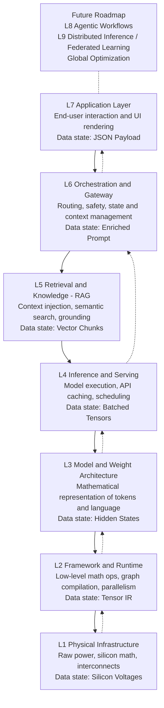
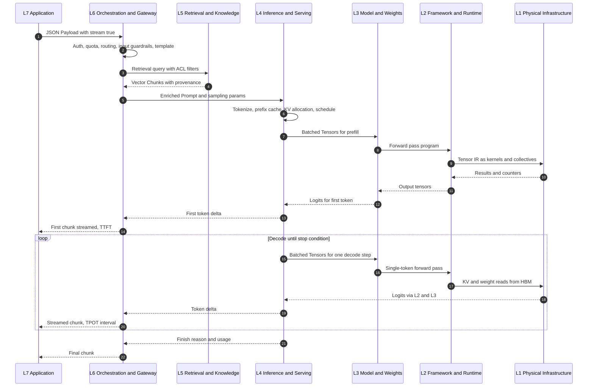
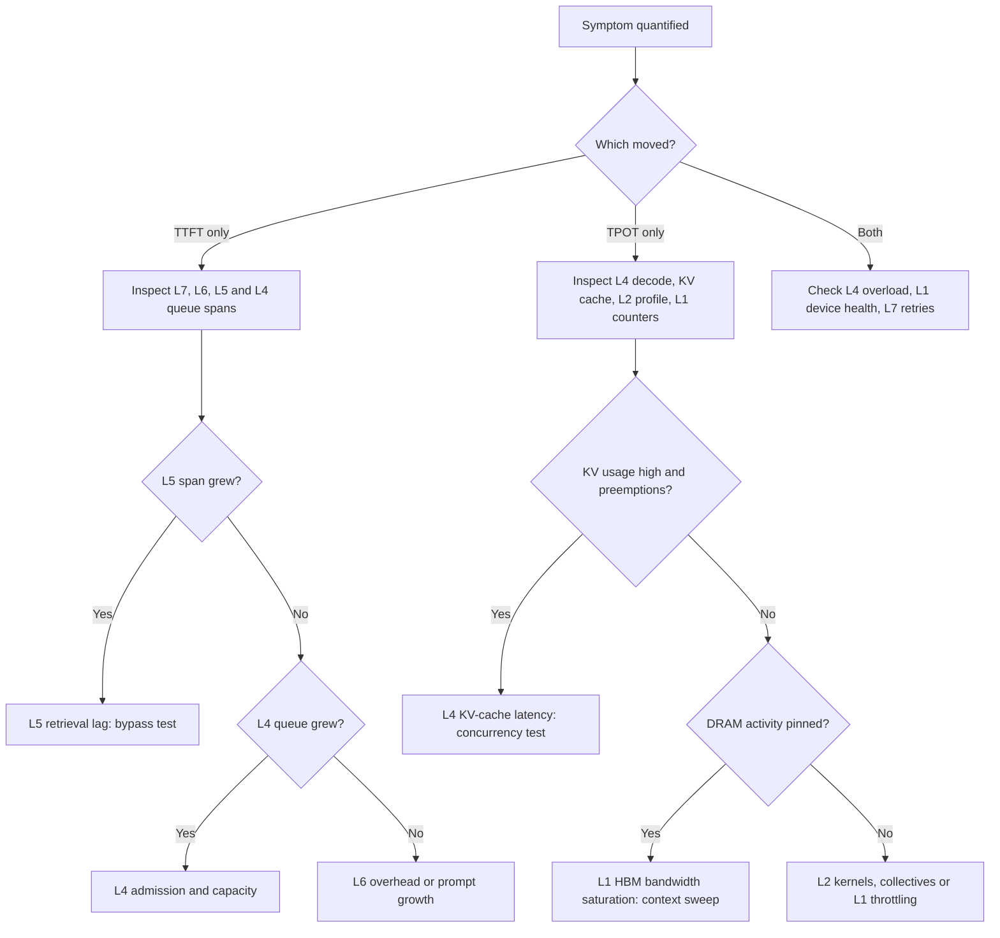

# **RFC [AOSI-RFC-0001]: The AI Open Systems Interconnection (AOSI) Reference Model: A 7-Layer Stack for Generative AI Execution**

| Field | Value |
|---|---|
| **RFC ID** | AOSI-RFC-0001 |
| **Title** | The AI Open Systems Interconnection (AOSI) Reference Model: A 7-Layer Stack for Generative AI Execution |
| **Version** | 1.2.1 (Final Draft for RFC) — *Version 1.2 - Advanced Implementation* |
| **Status** | Proposed Standard \| Draft for Public Comment |
| **Category** | Architectural Reference Model (Informational / Standards Track candidate) |
| **Author** | Divyendu Bhatt (Conceptual Architect) |
| **Contact** | https://github.com/CodingThrill0012 (GitHub: @CodingThrill0012) |
| **Repository** | https://github.com/CodingThrill0012/aosi-model |
| **Discussion** | https://github.com/CodingThrill0012/aosi-model/issues |
| **Date** | 2026-11-09 (this revision; originally drafted 2023-10-26) |
| **License** | Creative Commons Attribution 4.0 International (CC-BY-4.0) |

---

## **Abstract**

Generative AI systems execute across a deep, heterogeneous stack: client applications and APIs, orchestration gateways, retrieval pipelines, inference-serving engines, transformer model architectures, compiler and runtime frameworks, and accelerator hardware. Each tier has evolved its own abstractions, tooling and telemetry, but the industry lacks a shared reference model that names the tiers, defines the data state exchanged at each boundary, and assigns responsibility for performance, correctness and security.

This document specifies the **AI Open Systems Interconnection (AOSI) Reference Model**, a seven-layer conceptual stack for generative AI execution, from silicon (Layer 1) to the application (Layer 7). For each layer it defines purpose and scope, core components, the data-state transformation performed, interfaces to adjacent layers, observability signals and characteristic failure modes. It further specifies a layer-oriented **Diagnostic & Troubleshooting Matrix** — a "Wireshark for AI" method for isolating bottlenecks — summarizes **security considerations** per layer, and outlines a **future roadmap** for Layer 8 (Agentic Workflows), Layer 9 (Distributed Inference / Federated Learning) and cross-layer Global Optimization.

## **Status of This Memo**

This document is a **Proposed Standard** released as a **Draft for Public Comment**. It is not the product of any standards body and has not been adopted by any organization. Comments, errata and amendment proposals are invited through the repository issue tracker under the process defined in `CONTRIBUTING.md`. Distribution of this memo is unlimited under CC-BY-4.0.

---

## **Table of Contents**

1. [Introduction](#1-introduction)
2. [Conventions and Terminology](#2-conventions-and-terminology)
3. [Design Principles](#3-design-principles)
4. [Architecture Overview](#4-architecture-overview)
5. [Layer-by-Layer Specification](#5-layer-by-layer-specification)
6. [Request Lifecycle Walk-Through](#6-request-lifecycle-walk-through)
7. [Diagnostic & Troubleshooting Matrix](#7-diagnostic--troubleshooting-matrix)
8. [Security Considerations](#8-security-considerations)
9. [Future Roadmap](#9-future-roadmap)
10. [Related Work and Novelty](#10-related-work-and-novelty)
11. [Applying the Model](#11-applying-the-model)
12. [Revision History](#12-revision-history)
13. [License and Citation](#13-license-and-citation)
- [Appendix A: Technology-to-Layer Mapping](#appendix-a-technology-to-layer-mapping)
- [Appendix B: Proposed Telemetry Attributes](#appendix-b-proposed-telemetry-attributes)

---

## **1. Introduction**

### **1.1 Architectural fragmentation in modern AI**

The execution of a single generative request traverses at least seven distinct engineering disciplines. In practice these disciplines are separated by organizational boundaries (application, platform, ML, infrastructure teams), by tooling boundaries (APM tools, MLOps dashboards, GPU profilers, data-centre monitoring) and by vocabulary boundaries ("prompt", "batch", "graph", "kernel", "rail").

This fragmentation produces four systemic deficiencies:

1. **Non-attributable performance.** End-to-end latency is the composition of queueing, retrieval, prefill, decode, kernel execution and memory transfer. Without a layered decomposition, a regression in one tier is observed only as an aggregate symptom in another.
2. **Implicit contracts.** The interfaces between tiers — what a "prompt" contains when it reaches the serving engine, what a "batch" guarantees to the model, what a "graph" promises to the device — are defined by individual products rather than by a stable reference.
3. **Mis-located controls.** Security, privacy and governance controls are frequently specified as "AI controls" without regard to the tier at which the threat materializes, leaving gaps (e.g., grounding-data integrity) and duplications (e.g., output filtering at several tiers with inconsistent policy).
4. **Non-transferable expertise.** Engineers lack a common frame to describe *where* a behaviour originates, slowing incident response and design review.

### **1.2 Contribution of this document**

The OSI reference model (ISO/IEC 7498-1) demonstrated that a layered decomposition, with explicit service boundaries and named protocol data units, enables independent evolution of layers, precise fault localization and a shared professional vocabulary. AOSI adopts the same method for generative AI execution. Specifically, this document:

- defines **seven layers** with normative scope boundaries (§5);
- defines a canonical **data-state chain** — *JSON Payload → Enriched Prompt → Vector Chunks → Batched Tensors → Hidden States → Tensor IR → Silicon Voltages* — analogous to OSI protocol data units (§4.3);
- specifies a **request lifecycle** down and up the stack (§6);
- specifies a **layer-isolation diagnostic method** (§7);
- places **security considerations** at the layer where each threat materializes (§8);
- positions AOSI against prior standards, industry stack models and security frameworks (§10); and
- reserves **Layers 8 and 9** and a cross-layer optimization plane for future work (§9).

### **1.3 Scope and non-goals**

**In scope:** inference-time execution of generative models (primarily autoregressive transformer language models, and by extension multimodal models) from client request to device execution and back.

**Out of scope for this revision:**

- Training and fine-tuning pipelines, except where they share Layers 1–3 (see Layer 9, §9.2).
- Data governance processes upstream of the Layer 5 index (ingestion pipelines are referenced only at their interface).
- Any wire protocol, API schema or certification regime. AOSI is a **reference model**, not a protocol.
- Endorsement of any product. Named technologies are illustrative examples of components that occupy a layer.

---

## **2. Conventions and Terminology**

### **2.1 Requirements language**

The key words "**MUST**", "**MUST NOT**", "**REQUIRED**", "**SHALL**", "**SHALL NOT**", "**SHOULD**", "**SHOULD NOT**", "**RECOMMENDED**", "**NOT RECOMMENDED**", "**MAY**" and "**OPTIONAL**" in this document are to be interpreted as described in BCP 14 (RFC 2119, RFC 8174) when, and only when, they appear in all capitals, as shown here. In this document they apply to **descriptions and implementations that claim alignment with AOSI**, not to any product.

### **2.2 Terminology**

| Term | Definition |
|---|---|
| **Layer (Lₙ)** | A tier of the AOSI stack with a defined scope, data state and set of interfaces. L1 is closest to silicon; L7 is closest to the user. |
| **Data State** | The canonical representation of a request (or response) as it crosses a layer boundary. Analogous to an OSI protocol data unit. |
| **Boundary** | The interface between two adjacent layers, Lₙ/Lₙ₋₁. A boundary is where a data state is handed off and where telemetry SHOULD be emitted. |
| **Down-path** | Transformation of a request from L7 toward L1 (request ingestion, retrieval, prefill dispatch). |
| **Up-path** | Transformation of results from L1 toward L7 (logits, sampling, detokenization, streaming). |
| **Prefill** | The forward pass over all prompt tokens that populates the KV cache and produces the first output logits. Typically compute-bound. |
| **Decode** | The iterative, one-token-per-step (or k-tokens with speculative decoding) forward passes after prefill. Typically memory-bandwidth-bound at low batch sizes. |
| **KV cache** | Per-sequence storage of attention key and value tensors for prior tokens, avoiding recomputation during decode. |
| **TTFT** | Time to First Token: from request receipt to first output token emitted to the client. |
| **TPOT / ITL** | Time per Output Token / Inter-Token Latency: mean (or distribution of) intervals between successive output tokens. |
| **E2E latency** | End-to-end request latency, approximately `TTFT + (N_output − 1) × TPOT` for a streamed response. |
| **Goodput** | Throughput of requests that meet their latency service-level objectives (SLOs). |
| **Span** | An OpenTelemetry unit of traced work. AOSI-aligned tracing attributes each span to exactly one layer. |
| **Tensor IR** | Any intermediate representation of a computation graph or kernel below the framework API (e.g., TorchFX/Inductor graphs, StableHLO, MLIR dialects, PTX). |

### **2.3 Notation**

Layer references use the form **L1–L7**. A boundary is written **L5/L4**. "Illustrative" thresholds in §7 are examples for exposition, not normative values.

---

## **3. Design Principles**

1. **P1 — Single responsibility per layer.** Each layer MUST have one primary function. A component that spans layers (e.g., a serving engine with built-in kernels) SHOULD be described as occupying each layer separately.
2. **P2 — Named data state at every boundary.** Every boundary MUST have a defined data state, so that it can be captured, inspected and measured.
3. **P3 — Adjacency of interfaces.** A layer SHOULD interact only with its immediate neighbours. Cross-layer shortcuts (e.g., an application pinning a GPU) MUST be documented as explicit cross-layer couplings.
4. **P4 — Observability by construction.** Each layer SHOULD emit telemetry at its boundaries that is attributable to that layer, enabling isolation (§7).
5. **P5 — Technology neutrality.** Layer definitions MUST NOT depend on a specific vendor, framework or accelerator.
6. **P6 — Cost gradient awareness.** Latency and computational cost increase toward lower layers; semantic abstraction and policy surface increase toward upper layers. Optimizations SHOULD be evaluated against this gradient.
7. **P7 — Security at the point of materialization.** Controls SHOULD be placed at the layer where a threat materializes, with defense-in-depth at adjacent layers where justified.

---

## **4. Architecture Overview**

### **4.1 The stack**



*Solid arrows: down-path (request). Dotted arrows: up-path (response). L5 is normally traversed on the down-path only; the up-path from L4 returns to L6 for output policy and to L7 for delivery.*

> **Axis note:** ↓ Latency and computational cost increase toward lower layers. ↑ Semantic abstraction and policy surface increase toward upper layers.

### **4.2 Summary table**

| Layer | Name | Primary Function | Core Components (illustrative) | Data State (output, down-path) |
|:---:|---|---|---|---|
| **L7** | Application Layer | End-user interaction and UI rendering | Chat UIs, IDEs, web apps, copilots, agents; OpenAI-compatible APIs | **JSON Payload** |
| **L6** | Orchestration & Gateway | Routing, safety, state and context management | API gateways, LangChain, LlamaIndex, prompt templates, guardrails | **Enriched Prompt** |
| **L5** | Retrieval & Knowledge (RAG) | Context injection, semantic search, grounding | Vector DBs (Pinecone, Milvus), embedding models, chunkers, rerankers | **Vector Chunks** |
| **L4** | Inference & Serving | Model execution, API caching, scheduling | vLLM, TensorRT-LLM, TGI, Triton Inference Server, PagedAttention, KV cache | **Batched Tensors** |
| **L3** | Model & Weight Architecture | Mathematical representation of tokens and language | Transformer blocks, attention heads, activations, quantized weights | **Hidden States** |
| **L2** | Framework & Runtime | Low-level math ops, graph compilation, parallelism | PyTorch, JAX, Triton compiler, DeepSpeed, Megatron-LM, NCCL | **Tensor IR** |
| **L1** | Physical Infrastructure | Raw power, silicon math, interconnects | GPUs (e.g., H100), accelerators, HBM, NVLink/InfiniBand, power & cooling | **Silicon Voltages** |

### **4.3 The canonical data-state chain**

```text
 L7  JSON Payload       {"model": ..., "messages": [...], "stream": true}
  │
 L6  Enriched Prompt    system policy + template + session state + user turn (policy-checked)
  │
 L5  Vector Chunks      query embedding → top-k retrieved chunks (+ scores, provenance) merged into context
  │
 L4  Batched Tensors    token IDs, position IDs, attention metadata, KV-cache block tables, batch slots
  │
 L3  Hidden States      per-layer activations [batch × seq × d_model] → logits [batch × vocab] → probabilities
  │
 L2  Tensor IR          lowered/fused graph → kernels (GEMM, attention, norm) + collective schedule
  │
 L1  Silicon Voltages   MAC operations on tensor cores, HBM transactions, link signalling, power draw
```

---

## **5. Layer-by-Layer Specification**

Each layer is specified with six normative subsections: **Purpose & Scope**, **Core Components**, **Data State Transformation**, **Interfaces**, **Key Metrics & Observability Signals**, and **Failure Modes**.

### **5.7 Layer 7 — Application Layer**

**Purpose & Scope.** L7 is the point of end-user interaction and UI rendering. It captures user intent, serializes it into a machine request, and renders the streamed response. L7 owns user experience, client-side session handling, authentication of the end user to the application, and presentation of results (including citations and tool outputs). L7 MUST NOT embed model-specific prompt construction logic that belongs to L6.

**Core Components.**
- Chat UIs, IDE assistants, web and mobile applications, copilots, end-user-facing agents.
- API clients and SDKs issuing OpenAI-compatible (or equivalent) JSON requests.
- Streaming transports: Server-Sent Events (SSE), WebSockets, gRPC streams.
- Client-side rendering: Markdown/code rendering, citation display, partial-output handling, cancellation.

**Data State Transformation.**

| Direction | Input state | Output state |
|---|---|---|
| Down-path | User intent (text, files, images, UI actions) | **JSON Payload** — e.g., `{model, messages[], tools[], temperature, max_tokens, stream}` |
| Up-path | Streamed response chunks (token deltas, tool-call deltas, finish reason, usage) | Rendered output to the user |

**Interfaces.**
- **L7 → L6:** HTTP(S)/gRPC request carrying the JSON Payload, end-user identity and session identifiers.
- **L6 → L7:** Stream of response chunks, terminal status (`finish_reason`), usage accounting and policy outcomes (e.g., refusal codes).

**Key Metrics & Observability Signals.** Client-perceived TTFT; client-perceived inter-token latency; time to render; request error rate by status class; cancellation and abandonment rate; payload size; client-side span (`aosi.layer=7`).

**Failure Modes.** Client timeouts shorter than server SLOs; buffering proxies that defeat streaming (whole-response delivery); malformed or oversized payloads; retry storms amplifying load on lower layers; rendering stalls misattributed to model latency.

---

### **5.6 Layer 6 — Orchestration & Gateway**

**Purpose & Scope.** L6 governs routing, safety, state and context management. It authenticates and authorizes the calling application, enforces quotas, selects the target model/endpoint, applies prompt templates and system policy, maintains conversation state and memory, invokes L5 when grounding is required, and applies input and output guardrails. L6 is the **policy enforcement point** of the stack.

**Core Components.**
- API gateways and AI gateways (authentication, rate limiting, quota, routing, failover, semantic/response caching).
- Orchestration frameworks: LangChain, LlamaIndex, and equivalent workflow engines.
- Prompt templates and chat templates; system-prompt management.
- Guardrails: input classifiers, PII redaction, jailbreak/prompt-injection detection, output moderation, schema validation for structured output.
- Session and memory stores (conversation history, summarization of long histories).
- Model routers (cost/latency/capability-based selection).

**Data State Transformation.**

| Direction | Input state | Output state |
|---|---|---|
| Down-path | **JSON Payload** | **Enriched Prompt** — ordered message sequence: system policy + template + session state/memory + (grounding slot) + user turn, with routing decision and policy verdicts attached |
| Up-path | Detokenized text stream from L4 | Policy-filtered, schema-validated response chunks to L7 |

**Interfaces.**
- **L6 → L5:** Retrieval query (raw or rewritten), tenant/ACL filter, top-k and score thresholds.
- **L5 → L6:** Ranked Vector Chunks with provenance metadata.
- **L6 → L4:** Final prompt (text or pre-templated messages), sampling parameters, priority/SLO class, routing target.
- **L4 → L6:** Token/text stream, usage, finish reason.

**Key Metrics & Observability Signals.** Gateway overhead latency; guardrail latency (input and output); routing decisions by model; cache hit rate (response/semantic cache); policy-violation and refusal rates; prompt token count after enrichment; rate-limit rejections; span `aosi.layer=6` with child spans per guardrail and template step.

**Failure Modes.** Prompt bloat from unbounded history (pushing load onto L4 prefill); guardrail latency dominating TTFT; streaming defeated by output moderation that buffers the full response; routing to an overloaded or wrong-capability endpoint; template mismatch with the model's chat template causing quality regressions; prompt injection passing policy checks.

---

### **5.5 Layer 5 — Retrieval & Knowledge (RAG)**

**Purpose & Scope.** L5 performs context injection, semantic search and grounding. It converts a query into an embedding, searches one or more indexes, reranks and filters candidates, and returns chunks that L6 merges into the Enriched Prompt. L5 owns the **retrieval index at query time** and the integrity of grounding data as served. Index construction (ingestion, chunking, embedding at write time) is referenced at its interface.

**Core Components.**
- Vector databases and ANN indexes (e.g., Pinecone, Milvus; HNSW, IVF, PQ index types).
- Embedding models (query and document encoders).
- Chunkers and document parsers (write-path interface).
- Hybrid retrieval (lexical BM25 + dense), metadata filters, ACL-aware retrieval.
- Rerankers (cross-encoders) and context compressors.

**Data State Transformation.**

| Direction | Input state | Output state |
|---|---|---|
| Down-path | Retrieval query from the Enriched Prompt (text + filters) | **Vector Chunks** — query embedding → top-k candidate vectors → reranked retrieved chunks (text, score, source URI, version, ACL tag), merged into the prompt context |

**Interfaces.**
- **L6 → L5:** Query, filters, k, budget (token or time).
- **L5 → L6:** Ordered chunks with scores and provenance; empty-result signal.
- **L5 → L4 (embedding inference, optional):** Embedding models MAY themselves be served by an L4 engine; such calls MUST be traced as nested L4 spans within the L5 span.

**Key Metrics & Observability Signals.** Embedding latency; ANN search latency (p50/p95/p99); rerank latency; recall@k / nDCG against an evaluation set; empty-result rate; retrieved-token count contributed to the prompt; index freshness (age of newest indexed document); span `aosi.layer=5`.

**Failure Modes.** Retrieval lag under load (ANN index not memory-resident, cold caches, network hops to a managed service); low recall from embedding/model mismatch or poor chunking; context dilution from excessive k; stale index; ACL leakage across tenants; poisoned or adversarial documents (see §8).

---

### **5.4 Layer 4 — Inference & Serving**

**Purpose & Scope.** L4 manages model execution as a service: tokenization, admission control, scheduling, batching, KV-cache management, API-level caching (e.g., prefix caching) and sampling orchestration. L4 converts many independent prompts into a sequence of batched forward-pass invocations on L3 and returns tokens as they are produced. L4 is where **request-level concurrency meets device-level parallelism**.

**Core Components.**
- Serving engines: vLLM, TensorRT-LLM, Hugging Face TGI, NVIDIA Triton Inference Server (and equivalents).
- Tokenizers/detokenizers (BPE, SentencePiece).
- Schedulers: continuous (iteration-level) batching, chunked prefill, priority and preemption policies, prefill/decode disaggregation.
- KV-cache managers: PagedAttention block allocation, prefix caching, eviction/swap, KV quantization.
- Decoding accelerators: speculative decoding (draft models, multi-token heads), constrained/structured decoding.
- Model replicas and parallelism configuration (tensor/pipeline/expert parallel degree) exposed to L2.

**Data State Transformation.**

| Direction | Input state | Output state |
|---|---|---|
| Down-path | Enriched Prompt (text/messages) | **Batched Tensors** — token-ID tensors, position IDs, attention metadata (sequence lengths, causal masks), KV-cache block tables, batch-slot assignments, sampling parameters |
| Up-path | Logits/probabilities per sequence from L3 | Sampled token IDs → detokenized text deltas → stream to L6 |

**Interfaces.**
- **L6 → L4:** Prompt, sampling parameters, max tokens, priority.
- **L4 → L3:** Per-iteration batch descriptor and input tensors; KV-cache pointers.
- **L3 → L4:** Logits (or sampled tokens if sampling is fused); updated KV-cache state.

**Key Metrics & Observability Signals.** Queue time (time waiting before first scheduling); TTFT (server-side); TPOT/ITL; prefill and decode throughput (tokens/s); running and waiting request counts; KV-cache utilization; prefix-cache hit rate; preemption/swap counts; batch size per iteration; speculative-decoding acceptance rate; span `aosi.layer=4` with child spans for `queue`, `prefill` and `decode`. (Engine metric names vary by product and version; e.g., vLLM exposes time-to-first-token, time-per-output-token, KV-cache usage and waiting-request gauges via Prometheus.)

**Failure Modes.** KV-cache exhaustion leading to preemption, recomputation or swapping and therefore TPOT spikes; head-of-line blocking from long prefills interfering with decode (mitigated by chunked prefill or disaggregation); over-batching that trades TPOT for throughput beyond SLO; low prefix-cache hit rate due to non-deterministic prompt prefixes from L6; tokenizer mismatch with the model.

---

### **5.3 Layer 3 — Model & Weight Architecture**

**Purpose & Scope.** L3 is the mathematical representation of tokens and language: the model architecture and its learned parameters. It defines what computation is performed for a given batch — embedding lookup, a stack of transformer blocks (attention, MLP or mixture-of-experts, normalization, residual connections) and the output projection to vocabulary logits. L3 owns numerical representation choices (precision and quantization of weights, activations and KV cache) as properties of the model artifact.

**Core Components.**
- Token and positional embeddings (e.g., rotary position embeddings).
- Transformer blocks: multi-head, grouped-query or multi-query attention; attention heads; feed-forward/MLP layers; MoE routers and experts; normalization (LayerNorm, RMSNorm); activations (e.g., GELU, SwiGLU).
- Weights and their formats: FP16/BF16, FP8, INT8, INT4 (weight-only or weight-and-activation quantization); adapters (e.g., LoRA).
- Output head and logit processing hooks (temperature, top-p/top-k, repetition penalties) where defined by the model contract.

**Data State Transformation.**

| Direction | Input state | Output state |
|---|---|---|
| Down-path | Batched Tensors (token IDs, positions, KV pointers) | **Hidden States** — per-block activations of shape `[batch, seq, d_model]`, attention outputs, expert-routed activations; final hidden state |
| Up-path | Final Hidden States | Logits `[batch, vocab]` → probabilities (softmax) → returned to L4 for sampling |

**Interfaces.**
- **L4 → L3:** Forward-pass invocation with batch descriptor.
- **L3 → L2:** The model expressed as a framework program (module graph) with parameter tensors; parallelism annotations.
- **L3 → L4:** Logits/probabilities and KV-cache writes.

**Key Metrics & Observability Signals.** Parameter count and active parameters per token (MoE); FLOPs per token (prefill vs decode); weight and KV-cache bytes per token; quantization error/perplexity delta versus reference precision; expert load balance (MoE); logit statistics (entropy, NaN/Inf detection); output quality evaluations.

**Failure Modes.** Numerical instability (overflow in low precision, NaN propagation); quality regression from aggressive quantization; MoE expert imbalance causing stragglers; context-length extrapolation failure beyond trained range; architecture/weights mismatch with serving configuration (e.g., wrong RoPE scaling).

---

### **5.2 Layer 2 — Framework & Runtime**

**Purpose & Scope.** L2 provides low-level math operations, graph compilation and parallelism. It lowers the L3 model program into executable kernels and collective communication schedules for the target device, manages device memory allocation and streams, and implements tensor, pipeline, data and expert parallelism. L2 is where **model math becomes device programs**.

**Core Components.**
- Frameworks: PyTorch (eager, `torch.compile`/Inductor), JAX.
- Compilers and IRs: XLA/StableHLO, MLIR, the Triton compiler, TensorRT builders, TVM-class compilers.
- Kernel libraries: cuBLAS/cuBLASLt, CUTLASS, cuDNN, FlashAttention, ROCm equivalents (rocBLAS, MIOpen).
- Device runtimes and drivers: CUDA, ROCm, vendor runtimes for TPUs/other accelerators; CUDA Graphs.
- Collective communication: NCCL, RCCL; parallelism frameworks such as DeepSpeed and Megatron-LM.

**Data State Transformation.**

| Direction | Input state | Output state |
|---|---|---|
| Down-path | Hidden-State computation (module graph + weights) | **Tensor IR** — captured/lowered graph (e.g., FX/Inductor IR, StableHLO, MLIR, PTX/SASS), fused kernels (GEMM, attention, norm, activation), launch configurations, collective schedules (all-reduce, all-gather, all-to-all) |
| Up-path | Kernel completion and device buffers | Output tensors materialized for L3 |

**Interfaces.**
- **L3 → L2:** Framework program and parameters.
- **L2 → L1:** Kernel launches, memory copies, collective operations over device interconnect, driver calls.
- **L1 → L2:** Completion events, error codes, hardware counters.

**Key Metrics & Observability Signals.** Kernel time breakdown (GEMM vs attention vs communication); kernel launch overhead and CPU-side gaps; achieved occupancy and arithmetic intensity (roofline position); collective-communication time and overlap with compute; compilation/recompilation events (graph breaks); allocator fragmentation. Tools: NVIDIA Nsight Systems / Nsight Compute, PyTorch Profiler, JAX/XLA profilers, ROCm profilers.

**Failure Modes.** Graph breaks and recompilation causing latency jitter; unfused or sub-optimal kernels; launch-bound execution at small batch sizes (mitigated by CUDA Graphs); collective stalls from topology-unaware placement; memory fragmentation leading to out-of-memory despite free capacity; driver/runtime version incompatibility.

---

### **5.1 Layer 1 — Physical Infrastructure**

**Purpose & Scope.** L1 supplies raw power, silicon math and interconnects. It comprises the accelerators that execute multiply-accumulate operations, the memory hierarchy that feeds them, the intra-node and inter-node fabrics that connect them, and the power and cooling envelope that constrains them. L1 is where **every abstraction above is paid for in joules, bytes and nanoseconds**.

**Core Components.**
- Accelerators: GPUs (e.g., NVIDIA H100-class), AMD Instinct-class GPUs, TPUs and other AI ASICs; tensor cores/matrix engines.
- Memory: HBM (e.g., HBM3/HBM3e), on-chip SRAM/caches, host DRAM, NVMe tiers (for KV or weight offload).
- Interconnects: NVLink/NVSwitch (intra-node), PCIe, InfiniBand and RoCE Ethernet (inter-node), NICs/DPUs.
- Facility: power delivery, power capping, air/liquid cooling, rack and cluster topology.

**Data State Transformation.**

| Direction | Input state | Output state |
|---|---|---|
| Down-path | Tensor IR as executable kernels and transfers | **Silicon Voltages** — switching activity in tensor cores (MAC operations), HBM read/write transactions, link signalling, measurable as power draw and heat |
| Up-path | Physical computation results | Bits in device memory, completion events and hardware counters exposed to L2 |

**Interfaces.**
- **L2 → L1:** Kernel launches, DMA transfers, collective traffic.
- **L1 → L2:** Results, interrupts/events, error signals (ECC, Xid-class errors), telemetry counters.

**Key Metrics & Observability Signals.** Streaming-multiprocessor/compute-unit activity; tensor-pipe activity; HBM (DRAM) bandwidth utilization; memory capacity used; NVLink/PCIe/InfiniBand throughput and errors; power draw versus cap; temperature; clock-throttle reasons; ECC and hardware error counts. Tools: NVIDIA DCGM (e.g., profiling fields for DRAM activity, SM activity, tensor-pipe activity, NVLink bytes; device fields for power, temperature, clock-event reasons, Xid errors), `nvidia-smi`, `rocm-smi`, fabric managers, facility BMS/DCIM.

**Failure Modes.** HBM bandwidth saturation during decode (memory-bound regime); thermal or power throttling reducing clocks; link degradation causing collective slowdowns; ECC/hardware faults; noisy neighbours under device partitioning (e.g., MIG) or shared fabrics; capacity exhaustion forcing offload to slower tiers.

---

## **6. Request Lifecycle Walk-Through**

### **6.1 Down the stack: ingestion, grounding and prefill**

1. **L7** — The user submits a question in a chat UI. The client issues a JSON Payload with `stream: true`.
2. **L6** — The gateway authenticates the application, enforces quota, selects a model endpoint, runs input guardrails, loads session history and applies the prompt template. It determines that grounding is required.
3. **L5** — The query is embedded, the vector index is searched with tenant ACL filters, candidates are reranked, and top-k chunks with provenance are returned. L6 merges them into the **Enriched Prompt**.
4. **L4** — The serving engine tokenizes the prompt, checks the prefix cache, allocates KV-cache blocks and admits the sequence into the next scheduling iteration, forming **Batched Tensors** with other in-flight sequences.
5. **L3** — The prefill forward pass computes **Hidden States** for all prompt tokens across all transformer blocks and writes keys/values into the KV cache.
6. **L2** — The runtime executes the corresponding **Tensor IR**: fused attention and GEMM kernels, plus collectives if the model is sharded.
7. **L1** — Tensor cores, HBM and interconnect execute the work as **Silicon Voltages**; prefill is predominantly compute-bound.

### **6.2 Up the stack: decode and token streaming**

8. **L3 → L4** — Final hidden states are projected to logits; L4 samples the first token. **TTFT is fixed at this point** (plus up-path transit).
9. **L4 → L6 → L7** — The token is detokenized and streamed through output guardrails to the client.
10. **Decode loop** — For each subsequent token, L4 schedules a decode iteration; L3/L2/L1 execute a single-token forward pass that reads the full KV cache and the weights from HBM. At typical batch sizes decode is **memory-bandwidth-bound**, so **TPOT is governed primarily by L1 memory bandwidth and L4 batching/KV-cache behaviour**.
11. **Completion** — On a stop condition, L4 frees KV-cache blocks (or retains them for prefix reuse), L6 records usage and policy outcomes, and L7 renders the final state.

### **6.3 Sequence diagram**



---

## **7. Diagnostic & Troubleshooting Matrix**

### **7.1 The "Wireshark for AI" principle**

Wireshark makes network faults tractable by decoding each captured packet layer by layer, so an engineer can assert *which* layer misbehaved. AOSI applies the same discipline to generative AI: **every request SHOULD produce a trace in which each span is attributed to exactly one AOSI layer, and each boundary hand-off is timestamped.** Diagnosis then proceeds by decomposition rather than intuition.

An AOSI-aligned deployment SHOULD:

1. Propagate a single trace context (W3C Trace Context via OpenTelemetry) from L7 through L4.
2. Tag every span with `aosi.layer` (Appendix B) and, where available, OpenTelemetry GenAI semantic-convention attributes (e.g., model name, input/output token usage).
3. Export L4 engine metrics (Prometheus or OTLP) and L1 device metrics (e.g., DCGM exporter) on a common time base, labelled with node, device and replica identifiers so that request spans can be joined to device telemetry.
4. Capture L2 profiles (Nsight Systems, PyTorch Profiler) on demand for representative requests.

### **7.2 Latency decomposition**

End-to-end latency for a streamed request decomposes as:

```text
E2E ≈ TTFT + (N_out − 1) × TPOT

TTFT ≈ t_L7_client + t_L6_gateway + t_L6_guardrails_in + t_L5_retrieval
       + t_L4_queue + t_L4_tokenize + t_L4_prefill(L3/L2/L1) + t_up_path_first_token

TPOT ≈ t_L4_schedule_iteration + t_decode_step(L3/L2/L1) + t_L6_guardrails_out_per_chunk
```

The two components isolate different layers:

- **TTFT inflated, TPOT normal** → look **above** L4 compute: L6 overhead, **L5 retrieval lag**, L4 queueing, or long-prompt prefill.
- **TPOT inflated, TTFT normal** → look **at or below** L4 decode: **KV-cache pressure/preemption (L4)**, batch-size growth (L4), **HBM bandwidth saturation (L1)**, throttling (L1), collective stalls (L2/L1), or buffering output guardrails (L6).
- **Both inflated** → systemic: overload (L4 queue), device degradation (L1), or retry storms (L7).

### **7.3 Isolating L4 KV-cache latency vs L5 RAG retrieval lag vs L1 HBM bandwidth saturation**

These three causes are routinely confused because each surfaces as "the model is slow". They are separable with the signals below. Thresholds are **illustrative only** and MUST be calibrated per deployment.

| Discriminator | **L5 RAG retrieval lag** | **L4 KV-cache latency** | **L1 HBM bandwidth saturation** |
|---|---|---|---|
| **Primary latency signature** | TTFT up; TPOT unchanged | TPOT up and spiky (and TTFT up if admission is blocked) | TPOT up, smoothly, tracking batch size and context length |
| **Where the time sits in the trace** | `aosi.layer=5` span (embed / ANN search / rerank) grows before any L4 span starts | L4 `queue` span grows; decode iterations show preemption/recompute gaps | L4 `decode` span grows uniformly per step; no extra queueing |
| **L4 engine metrics** | Normal queue and KV usage | KV-cache utilization near capacity; preemption/swap counters rising; waiting requests rising | KV usage may be moderate; running batch large; tokens/s per GPU plateaus |
| **L1 device metrics (e.g., DCGM)** | Normal | Not necessarily saturated; utilization may *drop* during preemption/recompute churn | DRAM-activity (memory bandwidth utilization) persistently near its ceiling during decode; tensor-pipe activity comparatively low |
| **Isolation test** | Bypass retrieval (fixed cached context of equal token length) and replay: TTFT recovers → L5 confirmed | Replay with reduced `max_num_seqs`/concurrency or larger KV budget: TPOT spikes disappear → L4 confirmed | Replay at fixed batch with growing context length/batch: TPOT scales roughly with bytes read per step while DRAM activity stays pinned → L1 confirmed |
| **Illustrative trigger** | L5 span p95 > 30% of TTFT | KV utilization > 90% with non-zero preemptions per minute | DRAM activity > 0.8 sustained during decode windows |
| **Remediation** | Keep ANN index memory-resident; co-locate vector DB; cache query embeddings; reduce k / rerank depth; parallelize retrieval with other L6 work | Enable/size prefix caching; KV-cache quantization (e.g., FP8); tune batch and admission limits; chunked prefill; prefill/decode disaggregation; increase replicas | Weight/KV quantization to reduce bytes per token; speculative decoding (more tokens per weight read); GQA/MQA models (L3); scale out via tensor parallelism; move to higher-bandwidth memory parts |

### **7.4 Diagnostic & Troubleshooting Matrix**

| # | Symptom | Suspected Layer | Telemetry / Tool | Isolation Test | Remediation |
|:---:|---|:---:|---|---|---|
| 1 | Response arrives all at once despite `stream: true` | L7 / L6 | Client timing of first byte vs first rendered chunk; proxy logs | Call L6 directly, bypassing CDN/proxy | Disable response buffering on proxies; use streaming-compatible output guardrails |
| 2 | Client timeouts while server reports success | L7 | Client vs server span durations | Compare client timeout with server p99 E2E | Align timeouts with SLO; implement cancellation propagation |
| 3 | TTFT high, constant overhead across all prompts | L6 | Gateway and guardrail spans | Disable guardrail chain in a test route | Parallelize guardrails; smaller classifier models; cache policy verdicts |
| 4 | Prompt token count growing per conversation turn | L6 | Enriched-prompt token count per request | Replay with history truncated | History summarization, windowing, memory retrieval instead of full replay |
| 5 | TTFT high only for grounded requests | L5 | L5 span breakdown: embed / search / rerank | Replay with retrieval bypassed (§7.3) | Index residency, co-location, embedding cache, lower k |
| 6 | Grounded answers cite wrong or stale sources | L5 | Retrieval evaluation (recall@k), index freshness metric | Query known-answer set against index | Re-chunk, re-embed with matched model, refresh index, add reranker |
| 7 | TTFT high under load, low at idle | L4 | Queue-time span; waiting-request gauge | Replay at reduced concurrency | Autoscale replicas; priority classes; admission control |
| 8 | TPOT spikes, intermittent | L4 | KV-cache utilization; preemption/swap counters | Reduce concurrency or increase KV budget (§7.3) | Prefix caching, KV quantization, chunked prefill, disaggregation |
| 9 | Low prefix-cache hit rate despite shared system prompt | L6 → L4 | Prefix-cache hit-rate metric; prompt diffs | Compare tokenized prefixes across requests | Make L6 templates deterministic; place variable content after shared prefix |
| 10 | Quality regression after deployment, latency fine | L3 | Eval suite deltas; logit entropy; quantization config | A/B against reference precision weights | Revisit quantization scheme; verify chat template and RoPE scaling |
| 11 | NaN/garbage output on long contexts | L3 / L2 | Logit NaN/Inf checks; activation statistics | Run same input in higher precision | Precision changes for unstable ops; verify context-length configuration |
| 12 | Latency jitter after model or framework upgrade | L2 | Compilation/recompilation logs; Nsight Systems timeline | Warm-up and replay with fixed shapes | Eliminate graph breaks; shape bucketing; CUDA Graphs |
| 13 | GPU utilization low at small batch, latency high | L2 | Nsight Systems: CPU launch gaps between kernels | Profile one decode step | CUDA Graphs; kernel fusion; larger effective batch |
| 14 | Multi-GPU replica slower than expected | L2 / L1 | NCCL timing; NVLink/IB throughput counters | Run collective benchmarks (e.g., nccl-tests) on the node | Topology-aware placement; adjust parallel degrees; fix degraded links |
| 15 | TPOT rises smoothly with batch and context length | L1 | DCGM DRAM activity; tensor-pipe activity | Fixed-batch context sweep (§7.3) | Quantization; speculative decoding; scale-out; higher-bandwidth parts |
| 16 | Throughput drops after sustained load | L1 | Power vs cap; temperature; clock-event/throttle reasons | Correlate drop with throttle events | Cooling remediation; power-cap policy; load spreading |
| 17 | Sporadic request failures on one node | L1 | Xid/ECC error counters; driver logs | Drain node and run diagnostics (e.g., DCGM diagnostics) | Replace/reset device; exclude node from scheduling |

### **7.5 Layer-by-layer triage procedure**

Diagnosis SHOULD proceed top-down for attribution and bottom-up for confirmation:

1. **Define the symptom quantitatively.** Express it as a change in TTFT, TPOT, E2E, error rate, goodput or quality, with percentile and time window.
2. **Decompose (§7.2).** Determine whether TTFT, TPOT or both moved. This halves the search space.
3. **Walk the trace top-down (L7 → L4).** Compare span durations per layer against a baseline window. The first layer whose span distribution shifted is the **candidate layer**.
4. **Check the boundary data state.** Verify that the data state entering the candidate layer is unchanged (e.g., prompt token count at L6/L4, k and chunk sizes at L5/L6, batch size at L4/L3). A changed input implicates the layer *above*.
5. **Correlate with lower-layer telemetry (L4 metrics → L2 profiles → L1 counters).** Join on time, replica, node and device identifiers.
6. **Run the isolation test** for the candidate layer (§7.3, §7.4), changing exactly one variable.
7. **Confirm bottom-up.** Ensure the lower layers are healthy under the isolation test, ruling out a masked L1/L2 cause.
8. **Remediate at the owning layer**, then re-measure the original symptom definition.
9. **Record** the incident with its AOSI layer attribution, enabling layer-level reliability metrics over time.



---

## **8. Security Considerations**

AOSI places each threat at the layer where it **materializes**, consistent with principle P7. Controls at adjacent layers provide defense-in-depth.

| Layer | Principal threats | Representative controls |
|---|---|---|
| **L7** | Direct prompt injection and jailbreak attempts; session hijacking; abuse/automation; leakage of sensitive output to unauthorized users | Strong end-user authentication; input size limits; abuse detection; output rendering that does not execute untrusted content (e.g., HTML/Markdown sanitization) |
| **L6** | Prompt injection (direct and indirect via tool or retrieved content); system-prompt disclosure; insecure tool/function invocation; quota bypass; cross-tenant state leakage | Policy enforcement point with input/output guardrails; strict separation of system, user and retrieved content; least-privilege tool scopes; per-tenant session isolation; audit logging |
| **L5** | Data poisoning of the corpus or index; indirect prompt injection embedded in documents; ACL bypass leading to unauthorized retrieval; embedding inversion leaking source text | Provenance and integrity checks on ingested documents; ACL-filtered retrieval enforced server-side; content scanning for injected instructions; access control on the vector store; encryption at rest |
| **L4** | Model extraction via high-volume querying; cross-request leakage through shared prefix/KV caches (timing side channels); denial of service via long prompts or unbounded generation | Rate limiting and anomaly detection; per-tenant cache isolation or partitioning where confidentiality requires it; token and time budgets; logprob exposure policy |
| **L3** | Backdoored or tampered weights; membership inference and training-data extraction; unsafe behaviour from fine-tuning or adapters | Signed and hash-verified model artifacts; model provenance (supply-chain attestation); red-team evaluation before promotion |
| **L2** | Supply-chain compromise of frameworks, kernels or compilers; unsafe deserialization of model files | Pinned and verified dependencies; SBOMs; safe serialization formats (e.g., safetensors); isolated build pipelines |
| **L1** | Hardware side channels (timing, power, memory residue between tenants); firmware compromise; physical access | Device isolation (dedicated devices or hardware partitioning), memory scrubbing between tenants, firmware attestation and updates, confidential-computing capabilities where available, physical security |

Implementations claiming AOSI alignment **SHOULD** document, per layer, which threats are in scope and which controls are applied, and **MUST NOT** rely on a single layer (e.g., L6 guardrails alone) as the sole control for threats that materialize at L5 or below.

---

## **9. Future Roadmap**

The following extensions are reserved. They are **informative** in this revision and will be specified in subsequent RFCs.

### **9.1 Layer 8 — Agentic Workflows**

**Scope.** Self-correcting planning and multi-agent orchestration above L7: agents that decompose goals into plans, invoke tools, observe results, critique and revise, and coordinate with other agents.

**Open questions.**
- The canonical data state for L8 (candidate: *Plan Graph* / *Task State*), and how it maps onto multiple L7 requests.
- Boundaries between L8 planning and L6 orchestration (tool routing, memory).
- Observability: trace models for long-running, branching, multi-agent executions; attribution of cost and latency to plan steps.
- Security: authority delegation, tool-permission scoping, loop and runaway-cost controls, inter-agent trust.

### **9.2 Layer 9 — Distributed Inference / Federated Learning**

**Scope.** Cross-region and federated serving and learning: inference spanning multiple clusters or regions, disaggregated prefill/decode across sites, edge–cloud split execution, and federated learning or adaptation where data cannot leave its jurisdiction.

**Open questions.**
- Whether L9 is a layer or a **cross-cutting plane** that spans L1–L4 across sites.
- Data states for cross-site KV-cache transfer and federated parameter updates.
- Data residency and regulatory constraints as first-class architectural inputs.
- Consistency, failover and model-version coherence across regions.

### **9.3 Global Optimization**

**Scope.** A cross-layer optimization plane targeting energy efficiency and near-zero-latency token delivery: joint tuning of L6 routing, L4 scheduling, L3 precision, L2 compilation and L1 power/placement against SLOs and energy budgets.

**Open questions.**
- Standard metrics (e.g., energy per output token, goodput per watt) and how to measure them consistently across layers.
- Feedback interfaces from L1 telemetry to L4/L6 control decisions.
- Guardrails ensuring global optimization does not violate per-layer security or quality constraints.

---

## **10. Related Work and Novelty**

*Informative.* AOSI is not the first layered description of AI systems, and it is not intended to replace any of the works below. This section records the prior work the model builds on, how AOSI relates to each, and what AOSI does and does not claim as new. References are listed in §10.6; every entry was checked to exist at the time of this revision.

### **10.1 Layered reference models and AI standards**

- **OSI Basic Reference Model (ISO/IEC 7498-1:1994; ITU-T X.200) [R1, R2].** AOSI borrows its method from OSI: a fixed number of layers, a service boundary between adjacent layers, a named data unit at each boundary and a model that "does not intend to serve as an implementation specification". AOSI applies that method to a different domain (generative AI execution on one or more accelerators). It does not define wire protocols, and it is not an extension of OSI.
- **ISO/IEC 22989:2022, AI concepts and terminology [R3].** This standard sets out vocabulary and concepts for AI across all types of organization. AOSI does not redefine general AI terms. Where a term in §2.2 overlaps with ISO/IEC 22989, the ISO/IEC definition should take precedence, and future revisions of this RFC SHOULD align their terminology with it.
- **ISO/IEC 23053:2022, Framework for AI systems using machine learning [R4].** This standard describes the components and functions of ML-based AI systems in a structured, technology-neutral way, covering the whole ML system. AOSI is narrower and more operational. It covers **inference-time execution of generative models**, splits that execution into seven layers from the API payload down to device execution, and names the data state at each boundary. In practice, ISO/IEC 23053 helps describe *what* an ML system consists of, and AOSI helps locate *where* in the serving path a behaviour, cost or fault occurs.
- **NIST AI Risk Management Framework 1.0 (NIST AI 100-1) and the Generative AI Profile (NIST AI 600-1) [R5, R6].** These are organizational risk-management frameworks (Govern, Map, Measure, Manage). They are not technical layer models. AOSI complements them by giving a technical location for the measurement and controls that the RMF calls for. For example, the "Measure" and "Manage" activities for a retrieval system can be scoped to L5.

### **10.2 Industry AI / LLM stack models**

- **a16z, "Emerging Architectures for LLM Applications" (2023) [R7].** This widely referenced reference architecture describes the components of an LLM application: data pipelines, embedding models, vector databases, orchestration, APIs and plugins, LLM caches, logging and validation, and app hosting. Its focus is the **application tier**, which roughly corresponds to AOSI L5–L7. It does not break down serving, model, framework or hardware tiers, and it does not define boundary data states.
- **Google Cloud, "MLOps: Continuous delivery and automation pipelines in machine learning" [R8].** This reference describes MLOps maturity levels and the pipeline components for training, validating and deploying models (CI/CD/CT). It is organized around the **ML lifecycle**, not around the layers that one inference request passes through. AOSI's out-of-scope training concerns (§1.3, §9.2) are where lifecycle models such as this apply.
- **MLCommons MLPerf Inference [R9].** This is a benchmark suite, not a layer model. It is relevant because it measures system-level inference performance that, in AOSI terms, depends jointly on L1–L4. AOSI's latency decomposition (§7.2) is meant to explain *which layer* drives a benchmark result.
- **Serving-system research, e.g. PagedAttention / vLLM [R10].** Work like this shows that bottlenecks at the serving tier (KV-cache memory management) can dominate throughput. That evidence supports treating L4 as a separate layer, distinct from L3 (model architecture) and L1 (memory hardware).

### **10.3 Security frameworks for AI systems**

- **OWASP Top 10 for LLM Applications 2025 [R11].** This is a ranked list of risk categories for LLM applications. It does not assign a location in the stack. AOSI §8 can be read as a placement of these categories by layer:

| OWASP LLM Top 10 (2025) | Primary AOSI layer(s) |
|---|---|
| LLM01 Prompt Injection | L6 (direct via L7; indirect via L5 content) |
| LLM02 Sensitive Information Disclosure | L6, L5, L3 |
| LLM03 Supply Chain | L2, L3 |
| LLM04 Data and Model Poisoning | L3 (weights), L5 (retrieval corpus) |
| LLM05 Improper Output Handling | L6, L7 |
| LLM06 Excessive Agency | L6 (and future L8, §9.1) |
| LLM07 System Prompt Leakage | L6 |
| LLM08 Vector and Embedding Weaknesses | L5 |
| LLM09 Misinformation | L5, L7 (cross-layer) |
| LLM10 Unbounded Consumption | L4, L6 |

- **MITRE ATLAS [R12]** is a knowledge base of adversary tactics and techniques against AI-enabled systems, modelled on MITRE ATT&CK. **NIST AI 100-2 E2025 [R13]** gives a taxonomy and terminology of adversarial machine-learning attacks and mitigations. Both describe *what* an adversary does. AOSI adds *where* the technique materializes, so that detection and controls can be placed at a specific layer under principle P7.
- **Google Secure AI Framework (SAIF) [R14]** is a conceptual framework of security practices for AI systems. AOSI is compatible with it and can serve as the layer index for mapping SAIF-style controls.

### **10.4 Other OSI-inspired AI layer models**

Several authors have proposed OSI-inspired layer models for AI. The ones identified for this revision are:

- **Shapiro et al., "Conceptual Framework for Autonomous Cognitive Entities" (ACE, arXiv:2310.06775, 2023) [R15].** A six-layer **cognitive architecture** for autonomous agents, running from an Aspirational Layer down to Task Prosecution. It layers an agent's *reasoning and control*, not the execution path of a request. It is relevant to AOSI's future L8 (Agentic Workflows).
- **Rodrigo-Ginés, "Toward an OSI-Inspired Stack for Agentic AI: From Fragmented Frameworks to Open Standards" (Zenodo, 2025, doi:10.5281/zenodo.17099409) [R16].** A seven-layer **interoperability** stack for multi-agent systems, from physical infrastructure and runtime up to agent-to-agent communication, coordination and governance. Its main concern is interoperability *between agents*. AOSI's concern is the execution path *within* one generative inference request.

AOSI does not claim to be the first OSI analogy for AI. Its scope (single-request generative inference execution) and its emphasis on boundary data states and diagnostics are what set it apart from these models.

### **10.5 Novelty claims and limitations**

On the evidence reviewed above, AOSI makes the following **specific** claims of contribution:

1. **An end-to-end, named data-state chain** for generative inference, *JSON Payload → Enriched Prompt → Vector Chunks → Batched Tensors → Hidden States → Tensor IR → Silicon Voltages* (§4.3). None of the works reviewed define one named data state at every boundary from the API down to the device.
2. **A full-depth split of the serving path.** AOSI places the application, orchestration, retrieval, serving, model, framework/compiler and hardware tiers in one ordered stack. Industry stack diagrams usually stop at the model API (application view) or start at the accelerator (infrastructure view).
3. **Per-layer diagnostics** (§7). AOSI provides a layer-isolation method and a troubleshooting matrix that attribute latency and failures to a single layer (e.g., L4 KV-cache pressure vs L5 retrieval lag vs L1 HBM bandwidth saturation), with proposed telemetry attributes (Appendix B).
4. **Cross-layer security placement** (§8, §10.3). Each threat is assigned to the layer where it materializes, which turns existing threat catalogues (OWASP, ATLAS, NIST AML) into a layer-indexed control map.

**Limitations.** AOSI is a conceptual, informational model. It has not been adopted or endorsed by ISO/IEC, ITU-T, IETF, NIST or any other body. Its layer boundaries have not yet been validated empirically across many production deployments. Training pipelines are out of scope for this revision. Reviewers are invited to submit counter-examples, overlapping prior art not listed here, and evidence for or against each novelty claim, through the process in `CONTRIBUTING.md`.

### **10.6 Informative references**

| Ref | Reference |
|---|---|
| [R1] | ISO/IEC 7498-1:1994, *Information technology — Open Systems Interconnection — Basic Reference Model: The Basic Model*. https://www.iso.org/standard/20269.html |
| [R2] | ITU-T Recommendation X.200, *Open Systems Interconnection — Basic Reference Model: The basic model*. https://www.itu.int/rec/T-REC-X.200 |
| [R3] | ISO/IEC 22989:2022, *Information technology — Artificial intelligence — Artificial intelligence concepts and terminology*. ISO/IEC JTC 1/SC 42. https://www.iso.org/standard/74296.html |
| [R4] | ISO/IEC 23053:2022, *Framework for Artificial Intelligence (AI) Systems Using Machine Learning (ML)*. ISO/IEC JTC 1/SC 42. https://www.iso.org/standard/74438.html |
| [R5] | NIST AI 100-1, *Artificial Intelligence Risk Management Framework (AI RMF 1.0)*, 2023. https://www.nist.gov/itl/ai-risk-management-framework |
| [R6] | NIST AI 600-1, *Artificial Intelligence Risk Management Framework: Generative Artificial Intelligence Profile*, 2024. https://doi.org/10.6028/NIST.AI.600-1 |
| [R7] | M. Bornstein and R. Radovanovic, "Emerging Architectures for LLM Applications," Andreessen Horowitz, 20 June 2023. https://a16z.com/emerging-architectures-for-llm-applications/ |
| [R8] | Google Cloud, "MLOps: Continuous delivery and automation pipelines in machine learning." https://cloud.google.com/architecture/mlops-continuous-delivery-and-automation-pipelines-in-machine-learning |
| [R9] | MLCommons, *MLPerf Inference: Datacenter*. https://mlcommons.org/benchmarks/inference-datacenter/ |
| [R10] | W. Kwon et al., "Efficient Memory Management for Large Language Model Serving with PagedAttention," SOSP 2023. arXiv:2309.06180. https://arxiv.org/abs/2309.06180 |
| [R11] | OWASP GenAI Security Project, *OWASP Top 10 for LLM Applications 2025*. https://genai.owasp.org/llm-top-10/ |
| [R12] | MITRE, *ATLAS (Adversarial Threat Landscape for Artificial-Intelligence Systems)*. https://atlas.mitre.org/ |
| [R13] | NIST AI 100-2 E2025, *Adversarial Machine Learning: A Taxonomy and Terminology of Attacks and Mitigations*. https://csrc.nist.gov/pubs/ai/100/2/e2025/final |
| [R14] | Google, *Secure AI Framework (SAIF)*. https://saif.google/ |
| [R15] | D. Shapiro, W. Li, M. Delaflor et al., "Conceptual Framework for Autonomous Cognitive Entities," arXiv:2310.06775, 2023. https://arxiv.org/abs/2310.06775 |
| [R16] | F.-J. Rodrigo-Ginés, "Toward an OSI-Inspired Stack for Agentic AI: From Fragmented Frameworks to Open Standards," Zenodo, 2025. https://doi.org/10.5281/zenodo.17099409 |

---

## **11. Applying the Model**

AOSI is intended for the following uses. None constitutes certification.

- **Architecture design and review:** describe a system by listing the components occupying each layer and the data states at each boundary; identify missing layers (e.g., no L5 integrity controls) and cross-layer couplings (P3).
- **Observability design:** instrument boundaries and tag spans with `aosi.layer` (Appendix B) so the §7 method is executable.
- **Incident management:** classify incidents by AOSI layer to identify recurring weak layers.
- **Security architecture:** map threats and controls per §8 and verify defense-in-depth.
- **Education:** provide a common vocabulary across application, platform, ML and infrastructure roles.

A description of a system **claiming AOSI alignment** SHOULD include: (a) the component inventory per layer; (b) the boundary data states; (c) the telemetry emitted per layer; (d) the security controls per layer; and (e) any documented cross-layer couplings.

---

## **12. Revision History**

| Version | Date | Description |
|---|---|---|
| 1.0 | 2023-10-26 | Originally drafted: initial conceptual definition of the seven-layer stack. |
| 1.2 | — | *Version 1.2 - Advanced Implementation:* layer definitions extended with components, data states and future roadmap. |
| 1.2.1 | 2026-11-09 | Final Draft for RFC: normative structure (BCP 14 language), per-layer interfaces, observability signals and failure modes, request lifecycle, Diagnostic & Troubleshooting Matrix, security considerations, Related Work and Novelty (§10), governance via `CONTRIBUTING.md`; citation metadata (`CITATION.cff`, `.zenodo.json`). |

---

## **13. License and Citation**

### **13.1 License**

© Divyendu Bhatt. Licensed under CC-BY-4.0.

This work is licensed under the **Creative Commons Attribution 4.0 International License (CC-BY-4.0)**. You are free to share and adapt this material for any purpose, including commercially, provided you give appropriate credit to **Divyendu Bhatt** as Conceptual Architect of the AOSI Reference Model, provide a link to the license, and indicate if changes were made. Full legal code: https://creativecommons.org/licenses/by/4.0/legalcode

### **13.2 Suggested citation**

```text
Bhatt, D. (2026). AOSI-RFC-0001: The AI Open Systems Interconnection (AOSI) Reference Model:
A 7-Layer Stack for Generative AI Execution. Version 1.2.1 (Final Draft for RFC),
Proposed Standard | Draft for Public Comment. https://github.com/CodingThrill0012/aosi-model
```

```bibtex
@techreport{bhatt2026aosi,
  author      = {Bhatt, Divyendu},
  title       = {{AOSI-RFC-0001}: The {AI} Open Systems Interconnection ({AOSI}) Reference Model: A 7-Layer Stack for Generative {AI} Execution},
  institution = {AOSI Model Repository},
  type        = {RFC},
  number      = {AOSI-RFC-0001},
  year        = {2026},
  note        = {Version 1.2.1, Final Draft for RFC. Proposed Standard, Draft for Public Comment. Licensed under CC-BY-4.0},
  url         = {https://github.com/CodingThrill0012/aosi-model}
}
```

---

## **Appendix A: Technology-to-Layer Mapping**

*Informative. Many products span layers; each entry lists the layer(s) at which the named capability operates.*

| Technology / Technique | Layer(s) | Notes |
|---|:---:|---|
| OpenAI-compatible chat/completions JSON API | L7 / L6 | Request format at L7; terminated and enforced at L6 |
| Server-Sent Events, WebSockets | L7 | Token streaming transport |
| API/AI gateways, rate limiters | L6 | Policy enforcement point |
| LangChain, LlamaIndex | L6 (invoking L5) | Orchestration; retrieval components operate at L5 |
| Guardrail frameworks, moderation classifiers | L6 | Input and output policy |
| Pinecone, Milvus, other vector DBs | L5 | ANN search over embeddings |
| Embedding models, rerankers | L5 (served via L4) | Retrieval-time inference |
| vLLM, TensorRT-LLM, TGI, Triton Inference Server | L4 (with L2 kernels) | Serving, scheduling, batching |
| PagedAttention, prefix caching | L4 | KV-cache management |
| Continuous batching, chunked prefill | L4 | Scheduling |
| Speculative decoding | L4 (with L3 draft model) | Decoding strategy |
| Transformer blocks, GQA/MQA, MoE | L3 | Model architecture |
| FP16/BF16/FP8/INT8/INT4 weights, LoRA adapters | L3 | Numerical representation of the artifact |
| FlashAttention | L2 | Attention kernel implementation |
| PyTorch, JAX, `torch.compile`, XLA, MLIR, Triton compiler | L2 | Framework and compilation |
| CUDA, ROCm, cuBLAS, CUTLASS, CUDA Graphs | L2 | Runtime and kernel libraries |
| NCCL/RCCL, DeepSpeed, Megatron-LM | L2 | Collectives and parallelism |
| Nsight Systems / Nsight Compute, PyTorch Profiler | L2 (observing L1) | Profiling |
| DCGM, `nvidia-smi`, `rocm-smi` | L1 | Device telemetry |
| H100-class GPUs, TPUs, AI ASICs, HBM3e | L1 | Compute and memory |
| NVLink/NVSwitch, PCIe, InfiniBand, RoCE | L1 | Interconnect |
| OpenTelemetry | Cross-layer | Trace and metric transport; see Appendix B |

## **Appendix B: Proposed Telemetry Attributes**

*Informative. Proposed for community review; complementary to OpenTelemetry GenAI semantic conventions, not a replacement.*

| Attribute | Type | Layer(s) | Description |
|---|---|:---:|---|
| `aosi.layer` | int (1–9) | All | AOSI layer to which the span is attributed |
| `aosi.data_state` | string | All | Data state produced at the span's boundary (e.g., `enriched_prompt`, `vector_chunks`) |
| `aosi.l6.prompt_tokens_enriched` | int | L6 | Prompt tokens after templating, history and grounding |
| `aosi.l6.guardrail.verdict` | string | L6 | Outcome of a guardrail check |
| `aosi.l5.top_k` | int | L5 | Number of chunks requested |
| `aosi.l5.chunks_returned` | int | L5 | Number of chunks returned after filtering/reranking |
| `aosi.l4.queue_time_ms` | double | L4 | Time from admission request to first scheduling |
| `aosi.l4.prefix_cache_hit_tokens` | int | L4 | Prompt tokens served from prefix cache |
| `aosi.l4.preempted` | bool | L4 | Whether the sequence was preempted at least once |
| `aosi.l4.batch_size_at_prefill` | int | L4 | Running batch size when prefill executed |
| `aosi.l1.device_id` | string | L1 (join key) | Device identifier for joining spans to device telemetry |

---

*End of AOSI-RFC-0001.*
